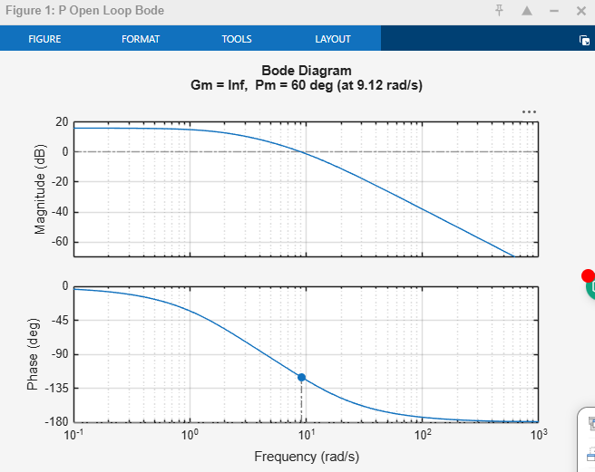
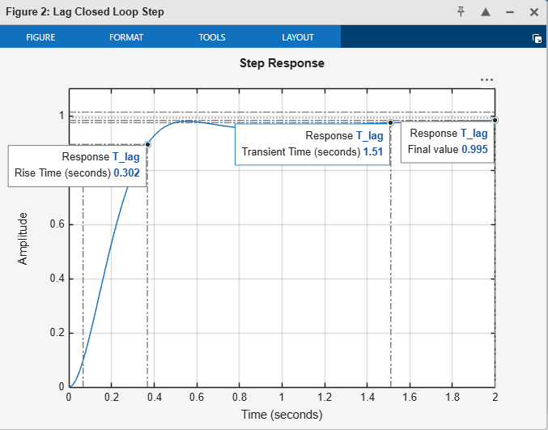
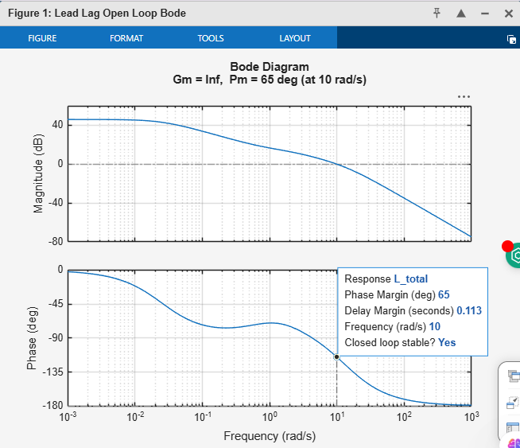

# DC Motor Speed Control — Frequency Response Design

**A fully calculated, reproducible MATLAB study of three controller stages:** P-only, Lag, and Lead–Lag. The main objective is to meet the speed-tracking requirements without randomly tuning gains or pole/zero locations. The final script compares all three controllers without exporting images. Seven MATLAB screenshots captured during the study are included directly in `figures/`.

> **Verification status:** the algebra and approximate step-response values below have been independently checked with Python/SciPy. **MATLAB was not installed in the packaging environment**, but the study author has provided screenshots from actual MATLAB runs, now included in this repository. This repository does **not** claim actual hardware tests or validated robustness.

## Study approach — decisions are explained at each stage

The following three stages are presented **in sequence**, rather than summarized only at the beginning. Each stage explains: **the problem inherited from the previous design → why this controller and these numerical targets were selected → the calculations → what the MATLAB plots show → what was solved and what remains**. The final comparison table is a recap, not a substitute for the stage-by-stage engineering reasoning.

## 1. Motor model, testing conditions, and requirements

The original plant uses armature voltage as input (V) and angular speed as output (rad/s):

$$
P(s)=\frac{\Omega(s)}{V(s)}=\frac{2}{s^2+12s+20.02}.
$$

We evaluate **closed-loop unity negative feedback** with a **1 rad/s reference step**, not the original open-loop 1 V motor test.

| Original requirement | Threshold | Interpretation |
|---|---:|---|
| 2% settling time | Tₛ < 2 s | Remain within ±2% of the **actual final value** (MATLAB `stepinfo` convention) |
| Percent overshoot | Mₚ < 5% | Limit peak above the **actual final value** |
| Unit-step tracking error | eₛₛ < 1% | Final speed should be within 1% of the 1 rad/s reference |

For the stable closed-loop transfer function T(s),

$$
Y(s)=T(s)\frac{1}{s},\qquad y_{ss}=\lim_{s\to0}sY(s)=T(0).
$$

Therefore, for a unit reference step,

$$
e_{ss}(\%)=\left[1-\operatorname{dcgain}(T)\right]\,100.
$$

This is **not** the same as the open-loop plant DC gain. `stepinfo` measures settling about the final response, so an apparently short settling time does **not** prove acceptable tracking accuracy. The phase-margin and crossover objectives introduced later are **additional engineering design choices**, not values uniquely dictated by the three requirements above.

---

## 2. Stage 1 — P-only: calculate the gain instead of guessing

### 2.1 First observation: the original motor Bode plot has no 0 dB crossover

**Before adding any controller, we examined the open-loop plant itself:**

$$
P(s)=\frac{2}{s^2+12s+20.02}.
$$

At DC (zero frequency), its gain is:

$$
P(0)=\frac{2}{20.02}\approx0.0999,
\qquad
20\log_{10}|P(0)|\approx-20.01\ \mathrm{dB}.
$$

**What does the negative magnitude mean?** In the Bode plot, **0 dB corresponds to magnitude 1**, and a **negative dB value corresponds to magnitude below 1**, not a negative output. Here, voltage is the input and speed is the output, so the plant magnitude expresses speed response per input voltage; this is a numerical frequency-response gain between *different physical units*.

For this motor, the plant magnitude stays below 0 dB at all frequencies and decreases further as frequency rises. Therefore, the **uncompensated plant has no gain crossover frequency** ω_gc satisfying:

$$
|P(j\omega_{gc})|=1\quad\text{(0 dB)}.
$$

The standard phase-margin calculation requires evaluating the open-loop phase **at the gain crossover**:

$$
PM=180^\circ+\angle L(j\omega_{gc}).
$$

**Because that crossover does not exist for L(s) = P(s), we cannot report a finite phase margin at a specific crossover frequency for the original plant.** MATLAB may display an **infinite phase margin** in this situation, indicating that no finite gain crossover is available for this calculation. It does **not** mean the motor is unstable, and it does **not** prove good tracking or infinite robustness.

**Why add a proportional gain first?** For a positive Kₚ:

$$
L_P(s)=K_PP(s),\qquad
20\log_{10}|L_P(j\omega)|=20\log_{10}|P(j\omega)|+20\log_{10}K_P.
$$

So a positive gain **raises the magnitude curve without changing the phase curve**. We can first select a desired phase-margin target, find the frequency where the *original* plant has the corresponding phase, and then calculate the exact Kₚ that raises the magnitude to **0 dB at that frequency**. This creates a designed gain crossover and makes phase-margin verification meaningful.

**One distinction matters:** the absence of an uncompensated 0 dB crossing is a *frequency-domain observation*, not by itself proof of unacceptable overshoot or tracking error. We establish those problems separately by checking the **closed-loop step response** after calculating Kₚ.

### 2.2 Stage 1: starting problem, objective, and reason for choosing P

**Problem at the start:** The uncompensated motor Bode magnitude stays below 0 dB, so there is no gain crossover from which to compute a finite phase margin. We also have a known DC motor model but no designed controller for tracking a 1 rad/s speed reference. We first need a simple baseline to see whether changing loop gain alone can meet *all three* requirements (Tₛ < 2 s, Mₚ < 5%, and eₛₛ < 1%).

**Why P-only first?** It has just one parameter, Kₚ, so it is the simplest frequency-domain starting point. We choose a **60° phase-margin design target** as an initial engineering objective, then derive the crossover and gain rather than guessing either value. This phase-margin target is *not* a direct mathematical conversion of the 5% overshoot limit.

**What we must check after the calculation:** A satisfactory phase margin and a fast-looking curve do **not** automatically guarantee low overshoot or accurate steady-state tracking. We will check both in the MATLAB step response before deciding whether compensation is needed.

A positive proportional gain Kₚ is the simplest controller. Before introducing compensators, we test whether simply changing loop gain can meet our needs. For a positive gain:

$$
L_P(s)=K_PP(s),\qquad T_P(s)=\frac{L_P(s)}{1+L_P(s)}.
$$

A positive constant Kₚ shifts the Bode **magnitude** vertically by 20 log₁₀(Kₚ) but **does not alter phase**. We use this fact to derive Kₚ from a chosen phase-margin target.

### 2.3 From 60° phase-margin objective to crossover frequency

We choose PM_target = 60° as a conventional *initial frequency-domain design objective*. It is **not** directly guaranteed by the 5% overshoot limit. The actual overshoot must be checked using the complete closed loop.

At gain crossover, the loop magnitude must equal one (0 dB):

$$
|L_P(j\omega_{gc})|=1.
$$

Phase margin at the same frequency is:

$$
PM=180^\circ+\angle L_P(j\omega_{gc}).
$$

Because Kₚ > 0 adds zero phase, our target imposes:

$$
\angle P(j\omega_{gc})=60^\circ-180^\circ=-120^\circ.
$$

**Now derive the frequency, step by step.** Substitute s = jω into the *known plant*:

$$
P(j\omega)=\frac{2}{(j\omega)^2+12j\omega+20.02}
=\frac{2}{(20.02-\omega^2)+j12\omega}.
$$

The numerator 2 has zero phase. The denominator must have phase **+120°**, because the transfer-function phase is numerator phase minus denominator phase. For the denominator to lie in quadrant II, ω² > 20.02. Its reference angle is 60°, so:

$$
\tan60^\circ=\frac{12\omega}{\omega^2-20.02}.
$$

Rearrange:

$$
\omega^2-12\cot60^\circ\,\omega-20.02=0.
$$

More generally, for a feasible target PM_target in this design setting,

$$
\omega_{gc}^2-12\cot(PM_{target})\,\omega_{gc}-20.02=0.
$$

Solve this quadratic and take the **positive** root:

$$
\omega_{gc}=\frac{12\cot(PM_{target})+\sqrt{[12\cot(PM_{target})]^2+4(20.02)}}{2}.
$$

With PM_target = 60°:

$$
\omega_{gc}\approx9.12\ \mathrm{rad/s}.
$$

This is the source of the MATLAB lines `b = 12*cotd(PM_target)` and `w_gc = (b + sqrt(b^2 + 4*20.02))/2`. The chosen **phase-margin target** gives the desired **crossover frequency**; we have **not** yet calculated controller gain.

### 2.4 From crossover frequency to proportional gain

At ω_gc the open-loop magnitude has to be 1:

$$
|K_PP(j\omega_{gc})|=1\ \Longrightarrow\ K_P=\frac{1}{|P(j\omega_{gc})|}.
$$

The magnitude of our second-order plant at any frequency is:

$$
|P(j\omega)|=\frac{2}{\sqrt{(20.02-\omega^2)^2+(12\omega)^2}}.
$$

Therefore:

$$
K_P=\frac{\sqrt{(20.02-\omega_{gc}^2)^2+(12\omega_{gc})^2}}{2}\approx63.3.
$$

This is exactly what `K_P = sqrt((20.02-w_gc^2)^2+(12*w_gc)^2)/2` computes. MATLAB `margin(L_P)` then **verifies** the crossover and phase-margin conditions.

### 2.5 Interpret the actual figures, not just their titles



**Bode interpretation:** the magnitude crosses **0 dB at 9.12 rad/s** and MATLAB reports **60° phase margin** (gain margin shown as infinite for the nominal model). The design succeeded at the *frequency-domain condition we imposed*. This does not yet establish time-domain compliance.


**Step-response interpretation:** MATLAB's annotated curve shows approximately **0.135 s rise time**, **0.67 s 2% settling time**, and **16.6% overshoot**. The final response is approximately **0.863** instead of 1 rad/s, so the **step-tracking error is about 13.7%**. The plot can look fast and settled while still missing the reference.

| P-only result | Original requirement | Assessment |
|---|---|---|
| Settling ≈ 0.67 s | <2 s | Pass |
| Overshoot ≈ 16.6% | <5% | **Fail** |
| Tracking error ≈ 13.7% | <1% | **Fail** |

**Why not just increase Kₚ?** Increasing gain improves the step error, but in this particular second-order closed loop,

$$
T_P(s)=\frac{2K_P}{s^2+12s+20.02+2K_P},\quad
\zeta=\frac{6}{\sqrt{20.02+2K_P}}.
$$

Thus increasing Kₚ **reduces damping ratio ζ**, generally increasing overshoot. We need to shape the loop, not just scale it.

**Stage 1 — outcome and remaining problems:** We achieved the designed **60° phase margin**, and the **0.67 s settling time passes**. But the actual closed-loop plot shows **16.6% overshoot** (fails the 5% limit) and **13.7% step error** (fails the 1% limit). **Both** issues remain. More proportional gain may reduce the error but further reduce damping. Therefore we cannot declare P-only successful.

**Why Stage 2 is Lag:** We need substantially greater **low-frequency loop gain** for steady-state accuracy without simply moving the gain crossover higher. We choose a Lag network and **re-design at a lower crossover** to allow more phase margin and improve transient behavior. This is an engineering response to the two observed P-stage failures, **not** a claim that a Lag automatically fixes overshoot; its step response must be checked.

**Next-stage question:** Can Lag correct the tracking error **and** bring overshoot below 5%, while still settling in under 2 seconds?

---

## 3. Stage 2 — Lag-only: solve the tracking problem, verify the transient trade-off

### 3.1 Stage 2: inherited problems, Lag choice, and the design constraints

**What Stage 1 did not solve:** P-only gave **16.6% overshoot** and **13.7% steady-state tracking error**. Our Lag-only design must fix *both* while preserving Tₛ < 2 s.

**Why use Lag?** Its pole-zero ratio can increase loop gain at low frequencies relative to the intended crossover, directly targeting the tracking error. For overshoot, the choice of Lag *alone* does not guarantee improvement. We also move to a **lower crossover** so the motor's phase is less negative, then verify the exact closed-loop step response.

**Why not keep 10 rad/s in this first Lag-only attempt?** At 10 rad/s the uncompensated motor phase is roughly −123.68°, giving only **56.32° phase margin** if 10 rad/s is made the gain crossover. Allowing another −15° from Lag at that same crossover would leave roughly **41.32°**, below our *chosen* 60° margin target. That **rejects this specific phase allocation at 10 rad/s**, not every possible Lag-only design there. We deliberately examine **5 rad/s** to obtain a healthier phase budget.

For a Lag network,

$$
C_{lag}(s)=K\frac{s+z}{s+p},\qquad 0<p<z.
$$

Because z/p > 1, its DC gain is Kz/p, while at sufficiently high frequency its gain approaches K. This provides **higher low-frequency loop gain** to reduce steady-state error. A Lag also introduces **negative phase** around its break frequencies, which can compromise phase margin if the crossover is placed too high.

The P-only attempt near **9–10 rad/s** already had roughly **56–60° phase margin before Lag**. A Lag phase contribution of −15° *at an unchanged 10 rad/s crossover* would bring the margin near **41.3°** (using the plant's phase at 10 rad/s); that is less than our provisional 60° objective. **This does not prove that every possible Lag-only design at 10 rad/s must fail**. It explains why we chose to test a *lower crossover*, instead of demanding that Lag both correct DC error and preserve a high crossover without phase help.

For this second-stage study, we chose these **explicit design targets**, then tested their success:

| Chosen objective | Value | Rationale |
|---|---:|---|
| Gain crossover | 5 rad/s | Lower plant phase lag, leaving room for compensator phase loss |
| Lag contribution at crossover | −15° | A permitted phase budget for this example, **not a universal rule** |
| Unit-step error target | 0.5% | Margin inside the original <1% accuracy limit |

Why **−15°**? At 5 rad/s, the plant phase is about **−94.74°**, leaving an unmodified margin of **85.26°**. A −15° contribution leaves approximately **70.26°**, still above our 60° initial design objective. Hence this phase allowance is derived from the **available margin budget** rather than chosen as a magic Lag rule. In fact, the largest allowed negative contribution to preserve at least 60° would be approximately 85.26° − 60° = 25.26°; −15° leaves about **10.26° additional buffer** within that budget. The precise allowance is an engineering preference, not a model-independent optimum.

### 3.2 Calculate all three Lag parameters from three conditions

Our unknowns are K, z and p. We derive one condition from the steady-state error, one from crossover **magnitude**, and one from crossover **phase**.

**Condition A — Step-tracking accuracy.** For stable unity feedback,

$$
e_{ss}=\frac{1}{1+L(0)},\qquad L(0)=P(0)K\frac{z}{p}.
$$

With e_target = 0.005, and P(0) = 2/20.02:

$$
Q\equiv\frac{Kz}{p}=\frac{1/e_{target}-1}{P(0)}=1991.99.
$$

`Q` is a **convenient shorthand for required controller DC gain**. It is *not* a second physical gain element.

**Condition B — 0 dB magnitude at the chosen crossover.** With ω_gc = 5 rad/s:

$$
|L(j5)|=1\ \Longrightarrow\
\left|K\frac{j5+z}{j5+p}\right|=M,\quad
M=\frac{1}{|P(j5)|}\approx30.1032.
$$

**Condition C — −15° Lag angle at crossover.** Since positive K contributes zero phase:

$$
\angle\!\left(K\frac{j5+z}{j5+p}\right)
=\tan^{-1}\!\left(\frac{5}{z}\right)-\tan^{-1}\!\left(\frac{5}{p}\right)=-15^\circ.
$$

This is the simple **angle-of-zero minus angle-of-pole** condition. For the algebraic solution used by our MATLAB code, represent the same targeted complex number as:

$$
K\frac{j5+z}{j5+p}=M\angle(-15^\circ)=R+jI,
\quad R=M\cos15^\circ,\quad I=-M\sin15^\circ.
$$

Use the DC constraint Kz = Qp to rewrite the Lag network:

$$
K\frac{s+z}{s+p}=K+\frac{(Q-K)p}{s+p}.
$$

Equating its real and imaginary parts at s = jω gives the closed-form equations:

$$
p=\frac{\omega I}{R-Q},\qquad
K=R+\frac{Ip}{\omega},\qquad
z=\frac{Qp}{K}.
$$

Substituting ω = 5 yields:

$$
C_{lag}(s)\approx29.04649\frac{s+1.36104}{s+0.0198462}.
$$

The Lag pole is at −0.0198462, and its zero at −1.36104; the positive gain is about 29.04649. **No pole/zero was randomly selected.** The independent *design targets* (5 rad/s, −15°, 0.5% error) remain explicit assumptions.

### 3.3 What do the Lag MATLAB figures actually demonstrate?


**Bode interpretation:** MATLAB shows **5 rad/s crossover** and **70.3° phase margin**, consistent with the 85.26° motor-only margin minus 15° allowed Lag contribution. The added compensator increases DC loop gain and reshapes low-frequency phase and magnitude. This is **not** a graph of the motor's physical speed versus time.



**Step interpretation:** The actual MATLAB screenshot shows **0.302 s rise time**, **1.51 s settling time**, and final response approximately **0.995** for a 1 rad/s reference. The computed unit-step error is therefore **0.5%**. The full-model numerical response is monotonic, giving approximately **0% overshoot**; the screenshot itself does not show a numerical overshoot annotation.

| Lag-only result | Original requirement | Assessment |
|---|---|---|
| Settling ≈ 1.51 s | <2 s | Pass |
| Overshoot ≈ 0% (numerical full model) | <5% | Pass |
| Error ≈ 0.5% | <1% | Pass |

**Stage 2 — what problems were solved?** Compared with P-only, the steady-state tracking error fell from **~13.7% to 0.5%** and overshoot from **16.6% to approximately 0%** (the latter is a numerical full-model result). The observed settling time is **1.51 s**, also below 2 s. **All three original requirements now pass.** This is what the Lag Bode plot and the Lag step plot *together* establish; the Bode plot alone does not prove the step-response limits.

**Stage 2 — what still remains?** **No original requirement failed.** The remaining issue is a **performance trade-off**, not a specification failure: the lower crossover is **5 rad/s**, and rise time is **0.302 s** rather than P-only's **0.135 s**. This is an acceptable design if the original three requirements are all we need, but it leaves room to investigate faster **initial** response.

**Why proceed to Stage 3?** We add a **new objective**: raise gain crossover to **10 rad/s** and aim for a faster rise while retaining the required tracking accuracy, overshoot and settling-time limits. At 10 rad/s, using Lag alone with a large negative phase allowance is less attractive because it spends phase margin. We therefore investigate **Lead–Lag**, letting the Lead supply positive phase while Lag continues to address the step error. We must still test the combined controller: higher crossover is not a guarantee of faster settling.

---

## 4. Stage 3 — Lead–Lag: recover phase and raise the crossover target

### 4.1 Stage 3: why Lead–Lag, what is new, and why limit Lag phase?

**What Stage 2 achieved:** Lag-only **already passed** all original requirements (1.51 s settling, ~0% overshoot, 0.5% error). **What we now want beyond those requirements:** a higher **10 rad/s crossover** and a faster rise than the 0.302 s Lag-only design. We are **not** trying to fix a failed Lag settling time or a failed Lag accuracy requirement.

**Why not simply demand 10 rad/s with the previous Lag?** A crossover shift changes the plant phase margin available, while Lag adds negative phase. That can leave insufficient phase budget. **Why Lead–Lag?** We preserve Lag's low-frequency gain benefit for tracking accuracy, and use a first-order Lead network to add the positive phase needed around 10 rad/s.

**What is the justification for −5° Lag?** At higher crossover we deliberately allocate only a small negative phase to Lag, to limit the positive boost required from Lead. More required Lead phase typically increases pole-zero separation and high-frequency gain, which may increase noise sensitivity and exposure to neglected dynamics. **−5° is a documented, testable engineering allowance**, not a uniquely derived optimum. We retain it only if the final nominal response meets all targets.

**Why 65° phase margin?** We aim 5° above the provisional **60° design objective** as an extra nominal margin. It does not prove robust behavior under motor-parameter changes or disturbances.

For this design, we *add* a target of **10 rad/s** gain crossover and choose a **65°** phase margin (5° above the provisional 60° goal). We keep the accuracy target at **0.5%**. Phase-margin safety allowance by itself does not prove robustness against parameter variation.

At 10 rad/s the plant phase is ∠P(j10) ≈ −123.6835°. A purely positive gain could give only:

$$
PM_{K\ only}(10)=180^\circ-123.6835^\circ=56.3165^\circ.
$$

To achieve 65°, the combined Lead and Lag must contribute **+8.6835° net**.

Why allocate only **−5°** to Lag, rather than −15° or −20° as before? This is a **conservative design decision**, with two rationales:

- At a **higher crossover** we want to avoid spending too much of the phase-margin budget on negative Lag phase; Lag's main role remains DC accuracy.
- Every extra negative degree must be recovered by the Lead network. Increasing Lead phase boost generally requires more pole–zero separation and higher high-frequency amplification, which can expose the feedback loop to more sensor noise or unmodeled high-frequency dynamics. It does not automatically imply instability, but it creates a real design trade-off.

For example, allocating **−15°** would require **+23.6835°** of Lead, rather than **+13.6835°** with −5°. The −5° allowance is not a hard physical limit or a proven global optimum; we **test the resulting design** and keep it only if the performance constraints are met. No claim is made that simply selecting −5° suppresses noise in a real device.

### 4.2 Calculate the Lead phase and its pole/zero parameters

Our complete controller is:

$$
C_{total}(s)=K\frac{s+z_l}{s+p_l}\underbrace{\frac{1+\tau s}{1+\alpha\tau s}}_{C_{lead}(s)}.
$$

The phase budget at the chosen crossover is:

$$
65^\circ=180^\circ+(-123.6835^\circ)+(-5^\circ)+\phi_{lead}.
$$

Rearrange, rather than guessing the Lead angle:

$$
\phi_{lead}=65^\circ-(180^\circ-123.6835^\circ)+5^\circ
=13.6835^\circ.
$$

For a first-order Lead network, 0 < α < 1 and:

$$
\phi_{max}=\sin^{-1}\!\left(\frac{1-\alpha}{1+\alpha}\right),\qquad
\omega_{max}=\frac{1}{\tau\sqrt{\alpha}}.
$$

Put its maximum phase benefit at the desired 10 rad/s crossover, i.e. ω_max = 10 rad/s. Solve:

$$
\alpha=\frac{1-\sin\phi_{lead}}{1+\sin\phi_{lead}}\approx0.617393,
\qquad
\tau=\frac{1}{10\sqrt{\alpha}}\approx0.127268\ \mathrm{s}.
$$

Therefore:

$$
C_{lead}(s)\approx\frac{1+0.127268s}{1+0.078575s}.
$$

The actual Lead zero and pole are approximately −7.857 and −12.727, respectively. The Lead is **normalized to unit DC gain**, so the final DC tracking requirement is still handled by the Lag–gain product.

### 4.3 Calculate Lag pole, Lag zero and overall gain after including Lead

Now K, pₗ and zₗ are the three remaining unknowns. We apply exactly the same three kinds of constraint as in Stage 2, but **include the Lead magnitude** in the crossover equation.

**Accuracy condition** (because C_lead(0) = 1):

$$
Q\equiv\frac{Kz_l}{p_l}=\frac{1/0.005-1}{P(0)}=1991.99.
$$

**Magnitude condition** at 10 rad/s:

$$
|C_{total}(j10)P(j10)|=1\ \Longrightarrow\
M\equiv\left|K\frac{j10+z_l}{j10+p_l}\right|
=\frac{1}{|P(j10)|\,|C_{lead}(j10)|}\approx56.65643.
$$

**Lag-angle condition:**

$$
\angle\!\left(K\frac{j10+z_l}{j10+p_l}\right)=-5^\circ,
\quad R=M\cos5^\circ,\quad I=-M\sin5^\circ.
$$

Since Q = Kzₗ/pₗ, the same real/imaginary identities give:

$$
p_l=\frac{10I}{R-Q}\approx0.025512,
\quad K=R+\frac{Ip_l}{10}\approx56.42824,
\quad z_l=\frac{Qp_l}{K}\approx0.900599.
$$

Our final calculated controller is:

$$
C_{total}(s)\approx56.42824
\frac{s+0.900599}{s+0.025512}
\frac{1+0.127268s}{1+0.078575s}.
$$

### 4.4 Interpret the Lead–Lag Bode plot and step response



**Bode interpretation:** the plotted loop crosses **0 dB at 10 rad/s**, while MATLAB reports **65° phase margin**. At that frequency:

| Component | Phase |
|---|---:|
| Original plant | −123.6835° |
| Lag contribution | −5° |
| Lead contribution | +13.6835° |
| Total loop | −115° |
| Phase margin | **65°** |

The zero-dB crossover must be verified **together with** the phase; adding phase angles at an arbitrary frequency does not by itself establish phase margin. The plotted gain margin is infinite in the nominal model, **not a promise of infinite real-world robustness**.


**Step interpretation:** MATLAB reports approximately **0.148 s rise**, **1.90 s settling**, **0.917% overshoot**, and final output **0.995**, meaning **0.5% reference step error**. The response rises faster than Lag-only, but **takes longer to settle** due to its complete higher-order closed-loop dynamics. The increased crossover is not equivalent to a faster settling time in every system.

| Lead–Lag result | Original requirement | Assessment |
|---|---|---|
| Settling ≈ 1.90 s | <2 s | Pass, **small margin** |
| Overshoot ≈ 0.917% | <5% | Pass |
| Error ≈ 0.5% | <1% | Pass |
| Crossover 10 rad/s | Additional Stage 3 objective | Achieved |
| Phase margin 65° | Additional Stage 3 objective | Achieved |

**Stage 3 — what did we achieve?** The final Bode plot confirms **10 rad/s crossover** and **65° phase margin**. The step plot confirms **0.148 s rise**, **1.90 s settling**, **0.917% overshoot**, and **0.5% tracking error**. Thus **the additional crossover objective and all three original requirements pass in the nominal model**. The initial rise improves from **0.302 s (Lag-only)** to **0.148 s (Lead–Lag)**.

**Stage 3 — what problems or trade-offs remain?** The increased crossover did **not** reduce settling time: it worsened from **1.51 s to 1.90 s**, leaving about **0.10 s** below the required limit. Overshoot also rises slightly (from ~0% to 0.917%), although it stays below 5%. Lead adds a second dynamic network, so noise sensitivity, control effort, actuator saturation, and parameter robustness still require evaluation before any hardware claim. **Lead–Lag is therefore a successful alternative for faster initial rise, not universally better than Lag-only.**

The overall controller—not one individual component—determines the actual transient response. A larger crossover does **not** mean a higher steady-state motor speed; the reference step remains 1 rad/s.

---

## 5. Final evidence and engineering conclusion

| Controller | Gain crossover | Phase margin | Rise time | 2% settling time | Overshoot | Tracking error | Original requirements |
|---|---:|---:|---:|---:|---:|---:|---|
| P-only | 9.12 rad/s | 60° | 0.135 s | 0.67 s | 16.6% | ~13.7% | **Fail** |
| Lag-only | 5 rad/s | 70.3° | 0.302 s | 1.51 s | ~0% (full-model numerical check) | 0.5% | **Pass** |
| Lead–Lag | 10 rad/s | 65° | 0.148 s | 1.90 s | 0.917% | 0.5% | **Pass** |


**Why the plot is zoomed to 0–1.2 s:** we intentionally emphasize differences in rise and initial overshoot, where the three curves separate most clearly. The zoom does **not** show final settling of Lag-only or Lead–Lag. The 1.51 s and 1.90 s values come from full-response analysis and the separate annotated MATLAB step plots.

**Decision:** Under the *original* three constraints, **Lag-only is already acceptable** and needs only a simple first-order network. **Lead–Lag is an optional performance trade-off** when a 10 rad/s crossover and faster initial rise are important enough to justify a second compensator. Neither design has been tested for robustness under parameter uncertainty, measurement noise, input-voltage saturation, or actuator limitations. In particular, the 1.90 s settling time of Lead–Lag leaves only ~0.10 s headroom in the nominal mathematical model.

---

## 6. MATLAB scripts and comparison workflow

Requires **MATLAB with Control System Toolbox** (`tf`, `evalfr`, `margin`, `feedback`, `stepinfo`, etc.). No Optimization Toolbox is necessary. These scripts use elementary calculations, not `fsolve`, automatic tuning, or guessed poles/zeros.

| File | Purpose |
|---|---|
| [`src/01_P_frequency_design.m`](src/01_P_frequency_design.m) | Compute P gain analytically from 60-degree phase-margin target |
| [`src/02_lag_frequency_design.m`](src/02_lag_frequency_design.m) | Compute Lag-only gain, pole, and zero |
| [`src/03_lead_lag_frequency_design.m`](src/03_lead_lag_frequency_design.m) | Compute final Lead and Lag networks and verify the closed loop |
| [`src/04_compare_controllers.m`](src/04_compare_controllers.m) | Rebuild all three stages, plot a zoomed step comparison, and print numerical performance results (no image exporting) |

**Suggested order:** run 01, 02, 03 to review each design, then run 04 for the zoomed comparison and numerical results. MATLAB screenshots are already included in `figures/`; image export is intentionally not part of the scripts.

The seven supplied screenshot files are documented in [`figures/README.md`](figures/README.md), and all image links in this README point to included files.

Optional interactive inspection:

```matlab
controlSystemDesigner('bode',P_motor,C_total);
```

Use the editor to inspect the **calculated** parameters and to study gain/phase trade-offs interactively. Keep any tuned variants separately identified; do not overwrite the analytical reference with undocumented tuning.

## 7. Scope and limitations

- Frequency-domain margin is a loop property; it is **not** the absolute phase shift of the motor alone.
- A target crossover of 10 rad/s concerns the **open-loop unity-gain crossing**, not the motor's physical steady-state speed, nor a requirement to perfectly track a 10 rad/s sinusoidal reference.
- Phase margin does **not** uniquely determine overshoot in these higher-order compensated closed-loop systems.
- Static unity-feedback controller models here omit voltage/current saturation, sensor noise, sampling/discretization, parameter drift and unmodeled dynamics.
- Before hardware implementation, verify control effort, noise sensitivity, robustness and safe actuator limits.


## MATLAB parameter guide

The scripts include each calculation as an ASCII MATLAB comment immediately before its corresponding assignment. In particular:

- `w_gc`: positive frequency satisfying the selected phase-margin condition (rad/s). The P-only script uses `cotd(PM_target)` so changing `PM_target` updates `w_gc`.
- `K_P`: proportional gain from the unity magnitude condition at `w_gc`.
- `Q`: required DC controller gain from the unit-step tracking error, `Q=(1/e_target-1)/dcgain(P_motor)`.
- `M`: required magnitude of the remaining controller block at crossover.
- `R`, `I`: real and imaginary parts of the targeted Lag-plus-gain response at crossover.
- `p`, `K`, `z`: Lag pole magnitude, positive gain, and Lag zero magnitude from coefficient matching of the complex response. The actual pole and zero are at `-p` and `-z`.
- `alpha`, `tau`: first-order Lead network parameters from required phase boost and crossover frequency.
- `T_*`: closed-loop transfer function used for `stepinfo`, `dcgain` and `pole`. `L_*`: open-loop transfer function used for `margin`.

The file `04_compare_controllers.m` recomputes `Q` from the error requirement instead of embedding a fixed number.
