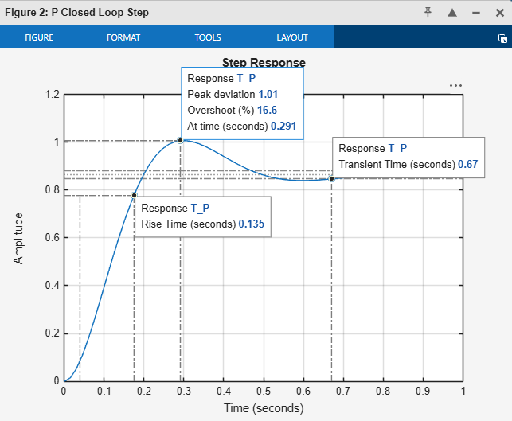
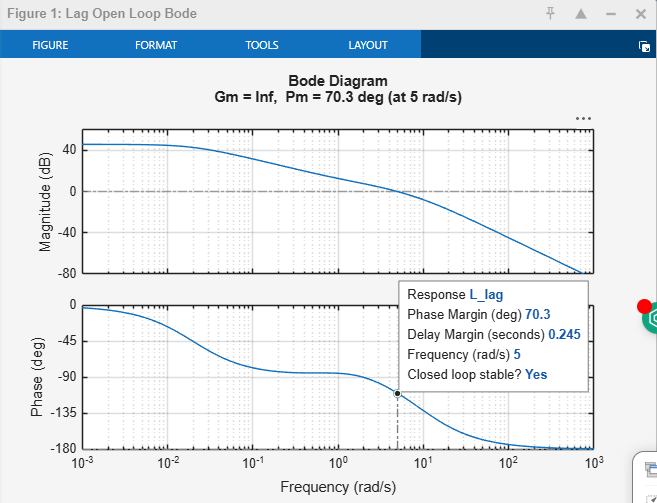
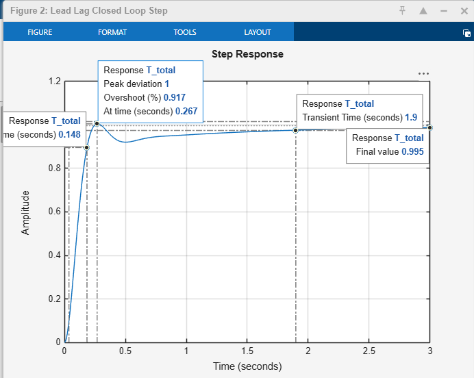
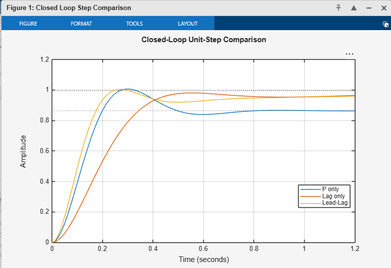

# DC Motor Speed Control — Frequency Response Design

**A fully calculated, reproducible MATLAB study of three controller stages:** P-only, Lag, and Lead–Lag. The main objective is to meet the speed-tracking requirements without randomly tuning gains or pole/zero locations. The final script compares all three controllers without exporting images. Seven MATLAB screenshots captured during the study are included directly in `figures/`.

> **Verification status:** the algebra and approximate step-response values below have been independently checked with Python/SciPy. **MATLAB was not installed in the packaging environment**, but the study author has provided screenshots from actual MATLAB runs, now included in this repository. This repository does **not** claim actual hardware tests or validated robustness.

## 1. Motor model and specifications

The armature voltage is the input (V); angular speed is the output (rad/s).

$$
P(s)=\frac{\Omega(s)}{V(s)}=\frac{2}{s^2+12s+20.02}.
$$

The closed-loop tests use unity negative feedback and a **1 rad/s reference step**, not the open-loop 1 V input test.

| Requirement | Limit |
|---|---:|
| 2% settling time | < 2 s |
| Overshoot | < 5% |
| Unit-step steady-state tracking error | < 1% |

The design additionally explores specified crossover frequencies and a phase-margin target. These are **design objectives**, not unique consequences of the three original time-domain specifications.

## 2. Stage 1 — P controller: compute gain from phase margin

At crossover, the loop magnitude is one and the phase margin is measured with respect to minus 180 degrees:

$$
|KP(j\omega_{gc})|=1,\qquad PM=180^\circ+\angle P(j\omega_{gc}).
$$

Select a target margin of 60 degrees as a design starting point. For this plant:

$$
P(j\omega)=\frac{2}{20.02-\omega^2+j12\omega}.
$$

For a general target $PM_{target}$ (degrees), the plant phase at crossover is $PM_{target}-180^\circ$. The positive crossover frequency follows from:

$$
\omega_{gc}^2-12\cot(PM_{target})\omega_{gc}-20.02=0.
$$

$$
\omega_{gc}=\frac{12\cot(PM_{target})+\sqrt{[12\cot(PM_{target})]^2+4(20.02)}}{2}.
$$

For $PM_{target}=60^\circ$, this gives approximately $9.12\ \mathrm{rad/s}$. Then the positive proportional gain is calculated from the magnitude condition:

$$
K_P=\frac{\sqrt{(20.02-\omega_{gc}^2)^2+(12\omega_{gc})^2}}{2}\approx63.3.
$$

This design meets its **frequency-domain phase-margin target**, but the full closed-loop system fails both the 5% overshoot and 1% error specifications. More P gain reduces error but further reduces damping.




## 3. Stage 2 — Lag only: improve low-frequency tracking

For the second stage, take an explicitly chosen crossover **5 rad/s**, allow 15 degrees of negative controller phase at crossover, and aim for 0.5% unit-step error. These are *design choices* whose effectiveness is confirmed with the full step response, not fixed rules.

$$
C_{lag}(s)=K\frac{s+z}{s+p},\qquad 0<p<z.
$$

**Three conditions determine the three unknowns:**

1. DC loop gain from tracking error:

$$
Q=\frac{Kz}{p}=\frac{1/e_{target}-1}{P(0)}=1991.99.
$$

2. Loop magnitude at crossover:

$$
M=\frac{1}{|P(j5)|}\approx30.1032.
$$

3. Desired lag phase of minus 15 degrees:

$$
K\frac{j5+z}{j5+p}=M\angle(-15^\circ)=R+jI,
$$

with the known rectangular parts:

$$
R=M\cos(15^\circ),\qquad I=-M\sin(15^\circ).
$$

To solve without nonlinear trial-and-error, rewrite the controller using the known DC constraint:

$$
K\frac{s+z}{s+p}=K+\frac{(Q-K)p}{s+p}.
$$

Matching real and imaginary parts at $s=j\omega$ gives the simple algebraic solution:

$$
p=\frac{\omega I}{R-Q},\qquad K=R+\frac{Ip}{\omega},\qquad z=\frac{Qp}{K}.
$$

The resulting controller is approximately:

$$
C_{lag}(s)=29.04649\frac{s+1.36104}{s+0.0198462}.
$$

The dominant intended improvement is **steady-state accuracy**. The complete third-order step response determines settling time and overshoot; phase margin alone does not guarantee either.



## 4. Stage 3 — Lead–Lag: higher crossover while keeping sufficient phase margin

The third stage targets **10 rad/s** crossover, **65-degree** phase margin, and **0.5%** steady-state error. The 65-degree target leaves an explicit 5-degree allowance above a *provisional* 60-degree phase-margin objective. It is **not** a demonstrated robustness guarantee.

We allocate only **minus 5 degrees** to the Lag network at crossover, so that the compensating Lead does not need excessive phase boost. This is a documented engineering choice, motivated by keeping the Lead network modest and reducing unnecessary high-frequency noise amplification; it is not a universal optimal limit.

### 4.1 Compute the Lead phase from the phase budget

The plant has:

$$
\angle P(j10)\approx-123.6835^\circ.
$$

The phase of a positive gain is zero. Therefore:

$$
\phi_{lead}=65^\circ-(180^\circ-123.6835^\circ)+5^\circ\approx13.6835^\circ.
$$

Use the normalized first-order Lead form:

$$
C_{lead}(s)=\frac{1+\tau s}{1+\alpha\tau s},\qquad 0<\alpha<1.
$$

Place the maximum phase boost at the desired crossover frequency:

$$
\alpha=\frac{1-\sin\phi_{lead}}{1+\sin\phi_{lead}}\approx0.617393,
\qquad \tau=\frac{1}{10\sqrt\alpha}\approx0.127268\ \mathrm{s}.
$$

Thus:

$$
C_{lead}(s)=\frac{1+0.127268s}{1+0.078575s}.
$$

This Lead alone has unit DC gain; the Lag and positive gain are calculated next.

### 4.2 Calculate the remaining Lag parameters and gain

The total controller is:

$$
C_{total}(s)=K\frac{s+z_l}{s+p_l}\,C_{lead}(s).
$$

The step-error target requires the **controller DC gain** to be:

$$
Q=\frac{Kz_l}{p_l}=\frac{1/0.005-1}{P(0)}=1991.99.
$$

The uncompensated plant and known Lead determine the required magnitude of the remaining Lag-plus-gain block at 10 rad/s:

$$
M=\frac{1}{|P(j10)|\,|C_{lead}(j10)|}\approx56.65643.
$$

The minus-5-degree lag constraint provides the third independent relation:

$$
\angle\left(K\frac{j10+z_l}{j10+p_l}\right)=-5^\circ.
$$

Writing the required complex response as $M\angle(-5^\circ)=R+jI$, where

$$
R=M\cos5^\circ,\qquad I=-M\sin5^\circ,
$$

the same algebraic identities from Stage 2 give:

$$
p_l=\frac{10I}{R-Q}\approx0.025512,
$$

$$
K=R+\frac{Ip_l}{10}\approx56.42824,
$$

$$
z_l=\frac{Qp_l}{K}\approx0.900599.
$$

**Final calculated compensator:**

$$
C_{total}(s)=56.42824\frac{s+0.900599}{s+0.025512}\frac{1+0.127268s}{1+0.078575s}.
$$

At 10 rad/s, the planned phase contributions are:

| Phase contribution | Value |
|---|---:|
| Plant | -123.6835 deg |
| Lag | -5.0000 deg |
| Lead | +13.6835 deg |
| Total open-loop phase | -115.0000 deg |
| Phase margin at crossover | **65.0000 deg** |

The magnitude is also constrained to 0 dB at crossover; checking phase alone would not be sufficient.




### 4.3 What changes, and what cannot be claimed?

- **Lag:** increases low-frequency loop gain relative to crossover, targeting the unit-step steady-state error; it introduces negative phase near crossover.
- **Lead:** introduces positive phase at crossover to recover the intended margin and modestly reshapes bandwidth and transient behavior; it is not in itself the source of DC error improvement in this normalized form.
- **Overall K:** is fixed with the compensator's magnitude, phase and DC error constraints, not picked independently from the plant Bode plot.
- **Overshoot and settling time:** belong to the **complete closed-loop transfer function**. Their changes cannot be assigned exclusively to either Lead or Lag.

## 5. Reference numerical comparison and specifications

The values below combine actual MATLAB screenshot readouts supplied by the study author with independent numerical checks (as labeled). Screenshot values are rounded to the visible precision. The Lag overshoot is approximately 0% from the theoretical full closed-loop response, not an explicitly displayed MATLAB overshoot annotation.

| Controller | Crossover | Phase margin | Settling time (2%) | Overshoot | Step error |
|---|---:|---:|---:|---:|---:|
| P-only | 9.12 rad/s | 60 deg | 0.67 s | 16.6% | ~13.7% |
| Lag-only | 5 rad/s | 70.3 deg | 1.51 s | ~0% (analytical) | 0.50% |
| **Lead–Lag** | **10 rad/s** | **65 deg** | **1.90 s** | **0.917%** | **0.50%** |

**Original requirements:** settling time < 2 s, overshoot < 5%, steady-state error < 1%. The Lag and Lead–Lag nominal mathematical models meet these three constraints. The Lead–Lag settling result is close to the 2 s limit, so a real design would also investigate model uncertainty and control effort. No robustness margin has been validated.



The comparison figure is deliberately zoomed to the initial **0–1.2 s** interval to make rise-time and overshoot differences visible. It does **not** display complete settling of the Lag or Lead–Lag responses. Read settling times from the full-model `stepinfo` values or annotated individual figures.


## 6. MATLAB scripts and comparison workflow

Requires **MATLAB with Control System Toolbox** (`tf`, `evalfr`, `margin`, `feedback`, `stepinfo`, etc.). No Optimization Toolbox is necessary. These scripts use elementary calculations, not `fsolve`, automatic tuning, or guessed poles/zeros.

| File | Purpose |
|---|---|
| [`src/01_P_frequency_design.m`](src/01_P_frequency_design.m) | Compute P gain analytically from 60-degree phase-margin target |
| [`src/02_lag_frequency_design.m`](src/02_lag_frequency_design.m) | Compute Lag-only gain, pole, and zero |
| [`src/03_lead_lag_frequency_design.m`](src/03_lead_lag_frequency_design.m) | Compute final Lead and Lag networks and verify the closed loop |
| [`src/04_compare_controllers.m`](src/04_compare_controllers.m) | Rebuild all three stages, plot a zoomed step comparison, and print numerical performance results (no image exporting) |

**Suggested order:** run 01, 02, 03 to review each design, then run 04 for the zoomed comparison and numerical results. MATLAB screenshots are already included in `figures/`; image export is intentionally not part of the scripts.

The seven supplied screenshot files are documented in [`figures/README.md`](figures/README.md), and all image links in this README point to included files.

Optional interactive inspection:

```matlab
controlSystemDesigner('bode',P_motor,C_total);
```

Use the editor to inspect the **calculated** parameters and to study gain/phase trade-offs interactively. Keep any tuned variants separately identified; do not overwrite the analytical reference with undocumented tuning.

## 7. Scope and limitations

- Frequency-domain margin is a loop property; it is **not** the absolute phase shift of the motor alone.
- A target crossover of 10 rad/s concerns the **open-loop unity-gain crossing**, not the motor's physical steady-state speed, nor a requirement to perfectly track a 10 rad/s sinusoidal reference.
- Phase margin does **not** uniquely determine overshoot in these higher-order compensated closed-loop systems.
- Static unity-feedback controller models here omit voltage/current saturation, sensor noise, sampling/discretization, parameter drift and unmodeled dynamics.
- Before hardware implementation, verify control effort, noise sensitivity, robustness and safe actuator limits.


## MATLAB parameter guide

The scripts include each calculation as an ASCII MATLAB comment immediately before its corresponding assignment. In particular:

- `w_gc`: positive frequency satisfying the selected phase-margin condition (rad/s). The P-only script uses `cotd(PM_target)` so changing `PM_target` updates `w_gc`.
- `K_P`: proportional gain from the unity magnitude condition at `w_gc`.
- `Q`: required DC controller gain from the unit-step tracking error, `Q=(1/e_target-1)/dcgain(P_motor)`.
- `M`: required magnitude of the remaining controller block at crossover.
- `R`, `I`: real and imaginary parts of the targeted Lag-plus-gain response at crossover.
- `p`, `K`, `z`: Lag pole magnitude, positive gain, and Lag zero magnitude from coefficient matching of the complex response. The actual pole and zero are at `-p` and `-z`.
- `alpha`, `tau`: first-order Lead network parameters from required phase boost and crossover frequency.
- `T_*`: closed-loop transfer function used for `stepinfo`, `dcgain` and `pole`. `L_*`: open-loop transfer function used for `margin`.

The file `04_compare_controllers.m` recomputes `Q` from the error requirement instead of embedding a fixed number.
