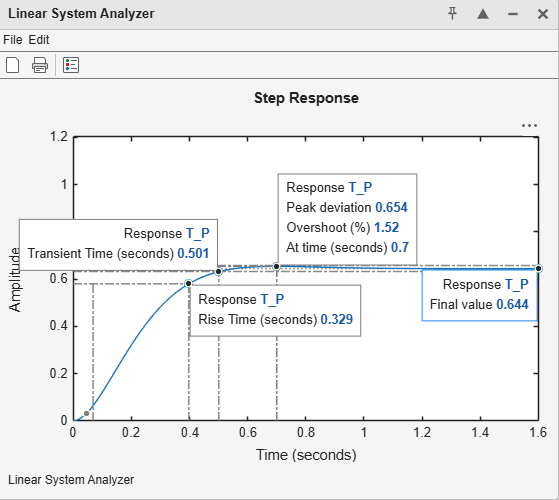
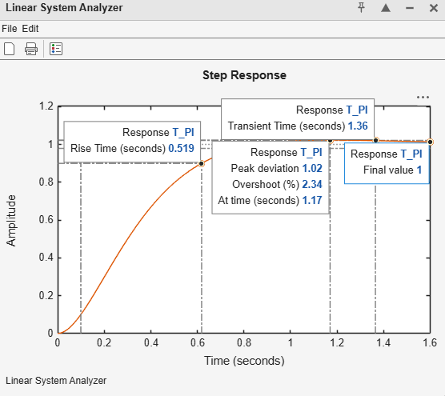
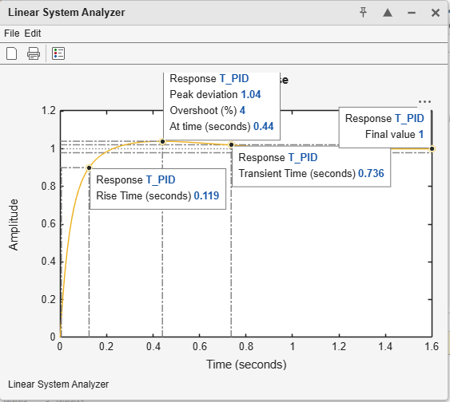
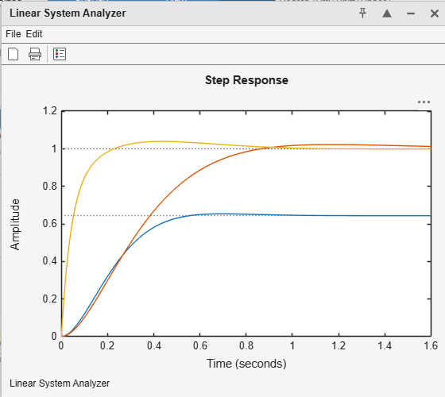
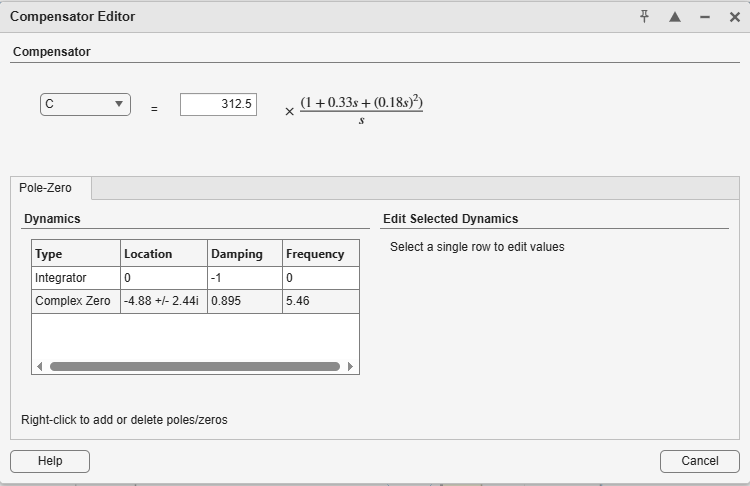
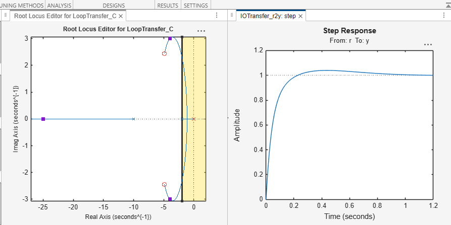
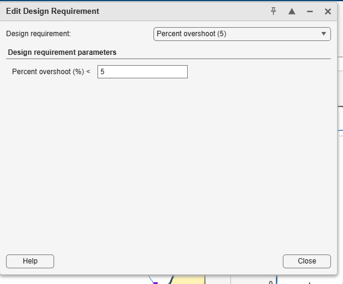

# DC Motor Speed Control — Analytical P, PI & PID Design

> **Workflow:** design from mathematical constraints → calculate gains → verify the **complete** closed-loop response in MATLAB → choose the simplest controller meeting the stated requirements.
>
> **Status:** MATLAB results and screenshots are supplied by the project author. This section documents a **nominal continuous-time linear model**, not a physical motor test.

## Contents

1. [Control objective and plant](#1-control-objective-and-plant)
2. [Design requirements and analysis method](#2-design-requirements-and-analysis-method)
3. [Stage I — Proportional controller](#3-stage-i--proportional-controller-p)
4. [Stage II — PI controller](#4-stage-ii--pi-controller)
5. [Stage III — PID controller](#5-stage-iii--pid-controller)
6. [Routh–Hurwitz stability constraints](#6-routhhurwitz-stability-constraints)
7. [Theoretical and MATLAB performance](#7-theoretical-and-matlab-performance)
8. [Control System Designer and graphical verification](#8-control-system-designer-and-graphical-verification)
9. [Engineering decision and limitations](#9-engineering-decision-and-limitations)
10. [How to run](#10-how-to-run)

## 1. Control objective and plant

This project continues the [System Modeling](../../System/Modeling/README.md) and [System Analysis](../../System/Analysis/README.md) stages of the **CTMS DC Motor Speed** example. The plant input is armature **voltage** `V` (V); its output is shaft **angular speed** `ω` (rad/s). The controller uses the **speed tracking error** `e(t)=r(t)-ω(t)` to command motor voltage `u(t)`. We assume ideal unity negative feedback, zero initial conditions, and the given continuous-time linear motor model.

```math
P(s)=\frac{\Omega(s)}{V(s)}
=\frac{0.01}{0.005s^2+0.06s+0.1001}
=\frac{2}{s^2+12s+20.02}
```

The reference `r(t)` is a **1 rad/s speed step**, *not* the 1 V armature-voltage step used in the open-loop system analysis.

For a controller `C(s)`:

```math
T(s)=\frac{\Omega(s)}{R(s)}=\frac{C(s)P(s)}{1+C(s)P(s)}
```

## 2. Design requirements and analysis method

| Requirement | Target | Interpretation |
|---|---:|---|
| Settling time (2% band) | **less than 2 s** | Last entry into the ±2% band around the final speed |
| Overshoot | **less than 5%** | Percentage above the final speed |
| Steady-state tracking error | **< 1%** | Relative to the 1 rad/s reference |
| Rise time (10–90%) | No specified maximum | Report 10–90% rise time for comparison |

**Design sequence:** P first; if its errors cannot meet all targets, add I and redesign. Adding D is examined as an *additional design option* to provide an independently assignable third-order characteristic polynomial—not because PI is inherently unstable or necessarily fails the original performance requirements.

The controllers' poles, predicted rise/settling times, overshoot, and tracking error are computed from equations before inspecting MATLAB results. Poles alone do not determine overshoot in systems that also have zeros.

## 3. Stage I — Proportional controller (P)

### 3.1 Closed-loop characteristic polynomial

```math
C_P(s)=K_p
```

```math
T_P(s)=\frac{2K_p}{s^2+12s+(20.02+2K_p)}
```

Compare with the standard second-order denominator:

```math
s^2+2\zeta\omega_n s+\omega_n^2
```

This gives:

```math
2\zeta\omega_n=12,\qquad\omega_n^2=20.02+2K_p
```

### 3.2 Design with overshoot and settling requirements

The classical zero-free second-order overshoot relation is:

```math
M_p=100\exp\left(-\frac{\pi\zeta}{\sqrt{1-\zeta^2}}\right)
```

For an overshoot below 5%, the damping ratio must exceed approximately 0.6901. Choose `ζ=0.8` as a design point with margin. From coefficient matching:

```math
\omega_n=\frac{12}{2(0.8)}=7.5\,\mathrm{rad/s}
```

```math
K_p=\frac{\omega_n^2-20.02}{2}=18.115
```

The resulting polynomial is `s²+12s+56.25` and the poles are `-6 ± j4.5`.

### 3.3 Steady-state error and why P is rejected

For a stable unit-step speed reference:

```math
e_{ss,P}=1-T_P(0)=\frac{20.02}{20.02+2K_p}
```

At `K_p=18.115`, `e_ss,P=35.5911%`. For P alone, keeping the final speed error strictly below 1% requires:

```math
\frac{20.02}{20.02+2K_p}<0.01
\quad\Rightarrow\quad K_p>990.99
```

In contrast, the 5% overshoot requirement constrains `ζ>0.6901`, yielding approximately `K_p<27.8` for the underdamped second-order design. These ranges are incompatible. A very large `K_p` would also request a very large initial voltage `u(0⁺)=K_p e(0⁺)` in the ideal unity-feedback model; no hardware voltage limit has been specified, so **physical feasibility must be checked separately**.

**Decision:** P fails the tracking-error requirement. Proceed to PI.



*Figure 1 — P: rise 0.329 s, settling 0.501 s, overshoot 1.52%, final value 0.644 rad/s.*

## 4. Stage II — PI controller

### 4.1 Add integral action

```math
C_{PI}(s)=K_p+\frac{K_i}{s}=\frac{K_ps+K_i}{s}
```

```math
T_{PI}(s)=\frac{2K_ps+2K_i}{s^3+12s^2+(20.02+2K_p)s+2K_i}
```

The integral action can remove the step tracking error **provided the closed-loop system is stable**.

### 4.2 Why a far-left third pole is constrained for PI

Write the desired third-order denominator as:

```math
D_d(s)=(s^2+2\zeta\omega_n s+\omega_n^2)(s+a)
```

Matching the `s²` coefficient gives:

```math
2\zeta\omega_n+a=12
```

If we *additionally* require `a ≥ 5ζω_n` as a rough dominant-pole separation guideline, then `ζω_n ≤ 12/7 ≈ 1.714`. Yet the common approximate 2% settling-time expression `T_s ≈ 4/(ζω_n)<2` requires `ζω_n>2`. Therefore **PI cannot satisfy both of these particular approximate pole-placement constraints simultaneously**. This **does not prove PI fails the real step-response requirements**. The five-times rule is a heuristic, not a stability theorem; zeros and modal residues matter.

### 4.3 Design PI using its full third-order model

Instead of neglecting a pole, select a desired **complete** characteristic polynomial with a stable triple pole at `s=-4`:

```math
D_d(s)=(s+4)^3=s^3+12s^2+48s+64
```

The repeated-pole choice is a **transparent candidate design**, compatible with the fixed `s²` coefficient; it is not a unique optimum.

Coefficient matching:

```math
20.02+2K_p=48\quad\Rightarrow\quad K_p=13.99
```

```math
2K_i=64\quad\Rightarrow\quad K_i=32
```

The full closed-loop model, including its zero, is:

```math
T_{PI}(s)=\frac{27.98s+64}{(s+4)^3}
```

For a unit speed step, the time-domain response is:

```math
y_{PI}(t)=1-e^{-4t}(1+4t-5.99t^2),\qquad t\geq0
```

It converges to 1 rad/s, so `e_ss=0`. The full response gives a 2% settling time near 1.365 s and an overshoot near 2.34%.

**Decision:** PI meets all three stated performance requirements in the nominal model. Its poles are repeated rather than separated; this is not a failure if the complete response meets the specification. Robustness remains untested.



*Figure 2 — PI: rise 0.519 s, settling 1.365 s, overshoot 2.34%, final value 1 rad/s.*

## 5. Stage III — PID controller

### 5.1 Why consider D?

Adding `K_d` permits independent adjustment of the `s²` denominator coefficient. We demonstrate the **optional** design route in which a faster third pole is intentionally assigned. This supports studying complete PID design even though PI already meets the original targets.

```math
C_{PID}(s)=K_p+\frac{K_i}{s}+K_ds
```

```math
T_{PID}(s)=\frac{2K_ds^2+2K_ps+2K_i}{s^3+(12+2K_d)s^2+(20.02+2K_p)s+2K_i}
```

### 5.2 Choose desired poles from performance targets

From the classical second-order relations, select `ζ=0.8` and `ω_n=5 rad/s` as a design candidate, giving `s_1,2=-4 ± j3`. Choose `s_3=-25`, satisfying the selected separation guideline `25/4=6.25>5`.

```math
D_d(s)=(s^2+8s+25)(s+25)=s^3+33s^2+225s+625
```

Coefficient matching yields:

```math
12+2K_d=33\quad\Rightarrow\quad K_d=10.5
```

```math
20.02+2K_p=225\quad\Rightarrow\quad K_p=102.49
```

```math
2K_i=625\quad\Rightarrow\quad K_i=312.5
```

Therefore:

```math
T_{PID}(s)=\frac{21s^2+204.98s+625}{s^3+33s^2+225s+625}
```

**Critical distinction:** the actual PID closed-loop response is not an ideal second-order response. The controller's two zeros influence peak and settling behavior despite the fast third pole. The **full transfer function** must be evaluated for numerical performance.

### 5.3 PID result and limitations

At the calculated gains, MATLAB reports `T_s=0.7359` s, `M_p=3.9984%`, and `e_ss=0` for the nominal continuous-time feedback model. The identified poles are `-25` and `-4 ± j3`.



*Figure 3 — PID: rise 0.119 s, settling 0.736 s, overshoot 4.00%, final value 1 rad/s.*

## 6. Routh–Hurwitz stability constraints

Routh–Hurwitz checks the **characteristic polynomial**, independently of plotting the roots. These inequalities establish linear closed-loop stability, **not** overshoot, speed, noise immunity, or acceptable voltage/current.

### 6.1 P controller

For `s²+12s+(20.02+2K_p)`, stability requires:

```math
K_p>-10.01
```

### 6.2 PI controller

For `D_PI(s)=s³+12s²+(20.02+2K_p)s+2K_i`, the Routh array is:

| Row | Column 1 | Column 2 |
|---|---|---|
| `s³` | `1` | `20.02+2K_p` |
| `s²` | `12` | `2K_i` |
| `s¹` | `(12(20.02+2K_p)-2K_i)/(12)` | `0` |
| `s⁰` | `2K_i` | `0` |

The resulting stability constraints are:

```math
K_p>-10.01,\qquad 0<K_i<120.12+12K_p
```

For the design `(K_p,K_i)=(13.99,32)`, `32<288` and the conditions hold.

### 6.3 PID controller

For `D_PID(s)=s³+(12+2K_d)s²+(20.02+2K_p)s+2K_i`:

| Row | Column 1 | Column 2 |
|---|---|---|
| `s³` | `1` | `20.02+2K_p` |
| `s²` | `12+2K_d` | `2K_i` |
| `s¹` | `((12+2K_d)(20.02+2K_p)-2K_i)/(12+2K_d)` | `0` |
| `s⁰` | `2K_i` | `0` |

Hence:

```math
K_d>-6,\quad K_p>-10.01,\quad 0<K_i<(6+K_d)(20.02+2K_p)
```

For our gains: `K_d=10.5>-6`, `K_p=102.49>-10.01`, and `312.5<3712.5`. The calculated model therefore satisfies these linear stability inequalities.

## 7. Theoretical and MATLAB performance

The exact time response is used for assessing each controller, rather than assuming that all closed-loop models are second order. Reported numbers below are **MATLAB outputs provided by the author**, matching an independent numerical model to displayed precision.

| Metric | Target | P | PI | PID |
|---|---|---:|---:|---:|
| Proportional gain (Kp) | — | 18.115 | 13.99 | 102.49 |
| Integral gain (Ki) | — | 0 | 32 | 312.5 |
| Derivative gain (Kd) | — | 0 | 0 | 10.5 |
| Rise time (s) | Not specified | **0.3291** | **0.5191** | **0.1192** |
| Settling time, 2% (s) | Below 2 | **0.5008** | **1.3648** | **0.7359** |
| Overshoot (%) | Below 5 | **1.5165** | **2.3378** | **3.9984** |
| Peak time (s) | — | 0.6985 | 1.1628 | 0.4347 |
| Final value (rad/s) | 1 | 0.6441 | 1.0000 | 1.0000 |
| Step tracking error (%) | Below 1 | **35.5911** | **0** | **0** |
| Routh stability | Stable | Pass | Pass | Pass |
| Meets all stated requirements? | — | **No** | **Yes** | **Yes** |

> **Measurement conventions:** `stepinfo` uses the 2% settling band by default and a 10–90% rise interval. `Peak`/`Overshoot` values are relative to the system's own steady-state final value, **not necessarily the commanded 1 rad/s**. This is especially relevant for P, where the peak value is ~0.654 but final speed is ~0.644.



*Figure 4 — All three closed-loop responses on a common 1 rad/s reference: P remains below target; PI and PID reach target. PID has the fastest rise, while PI has the lower overshoot.*

## 8. Control System Designer and graphical verification

### 8.1 What is the compensator, and why do we use it?

In Control System Designer, **compensator** is the name for the control block `C(s)` placed before the plant `P(s)`. In this project, our compensator is the **PID controller we designed mathematically**. It is not an additional device or a new transfer function that needs a separate set of gains.

The controller takes the speed error `E(s)` and produces the motor voltage command `U(s)`:

```math
U(s)=C(s)E(s)
```

The calculated ideal PID is:

```math
C(s)=K_p+\frac{K_i}{s}+K_ds
```

```math
C(s)=102.49+\frac{312.5}{s}+10.5s
```

Writing the same controller over one denominator makes its poles and zeros visible:

```math
C(s)=\frac{10.5s^2+102.49s+312.5}{s}
```

MATLAB may display this **same equation** in normalized time-constant form:

```math
C(s)=312.5\,\frac{1+0.327968s+0.0336s^2}{s}
```

The coefficients in the GUI may be **rounded**, so the displayed `0.33` and `(0.18s)²` are approximations, not new tuning results.

| Feature in Compensator Editor | Meaning |
|---|---|
| Gain = 312.5 | Scale factor of the normalized representation (equal to `K_i` in this form) |
| Integrator at `s=0` | Pole of `C(s)` introduced by the I term |
| Complex zeros near `-4.88 ± j2.44` | Zeros of the PID numerator, which can influence transient response |
| Purple closed-loop pole markers in Root Locus | Poles of the **complete closed-loop system**, not the integrator pole or controller zeros |

**Why this representation matters:** it lets us inspect the controller's pole-zero structure, import our analytically calculated PID into Control System Designer, and study the influence of gain and compensator dynamics on the full closed-loop response. It does **not**, by itself, prove that the design requirements are satisfied; the complete step response is checked separately.



*Figure 5 — Compensator Editor displaying the analytically calculated PID in normalized form.*

### 8.2 Root Locus Editor

The plot shows how closed-loop poles would move if loop gain changes while the compensator dynamics remain fixed. In the author's screenshot, the purple squares mark **the closed-loop poles at the loaded gain** (near `-25`, `-4 ± j3`); the crosses and open circles represent open-loop poles and zeros. The shaded area is a graphical design constraint and must not be mistaken for the pole locations themselves.



*Figure 6 — Calculated PID loaded into Control System Designer: Root Locus and closed-loop Step Response.*



*Figure 7 — Graphical overshoot requirement (less than 5%) in Control System Designer.*

**Important:** these graphical pole regions are often based on second-order approximations. Meeting a pole-location shading constraint does **not** replace measuring the full closed-loop response, particularly with controller zeros.

### 8.3 How MATLAB is used

- **Linear System Analyzer**: show the step response, peak response, rise time, settling/transient time, and steady-state value.
- **Control System Designer**: load a mathematically derived compensator, inspect its pole-zero structure, plot the root locus, visualize speed tracking, and show design requirements.
- **`stepinfo`, `dcgain`, and `pole` (in the optional comparison script)**: extract numerical results directly into the Command Window for repeatable verification; they are **not used to tune gains**.

Detailed design of root-locus geometry belongs to the separate `Control/Root_Locus` section.

## 9. Engineering decision and limitations

| Stage | Problem addressed | What remains | Decision |
|---|---|---|---|
| P | Fast response, low overshoot | Large steady-state tracking error | **Reject** |
| PI | Eliminates steady-state step error; meets all numeric requirements | Third pole not far-left; uncertainty/actuator checks remain | **Accept for nominal model** |
| PID | Offers extra pole-placement freedom and the fastest rise in these examples | Higher complexity and overshoot than PI; physical control effort is unverified | **Optional alternative** |

**Physical considerations:** the ideal PID contains derivative action on error. A step reference can cause a derivative kick, and the controller may command high voltage/current. A real implementation typically requires filtering, practical derivative placement, anti-windup, and actuator voltage/current limits, followed by new validation. Parameter uncertainty (`J,b,R,L,K`), disturbances, sample time, and sensor noise are outside the present nominal test.

**Final decision:** PI is the simpler controller satisfying the stated numerical requirements. PID is included as a justified analytical **pole-placement study**, not as proof of better real-hardware performance.

## 10. How to run

Open MATLAB with Control System Toolbox. Run each script independently from the `src/` folder:

| File | Purpose |
|---|---|
| [`01_P_controller.m`](src/01_P_controller.m) | Compute P gain and open annotated step response |
| [`02_PI_controller.m`](src/02_PI_controller.m) | Calculate PI gains from coefficient matching |
| [`03_PID_controller.m`](src/03_PID_controller.m) | Calculate PID gains and open Control System Designer |
| [`04_compare_controllers.m`](src/04_compare_controllers.m) | Visualize all three, print numerical performance/poles to Command Window |
| [`05_control_system_designer.m`](src/05_control_system_designer.m) | Open the already-calculated PID in Root Locus Editor |

To annotate plots, right-click a step plot → **Characteristics** and select **Rise Time**, **Settling Time**, **Peak Response**, and **Steady State**. Menu labels may differ slightly by MATLAB release. The 1 rad/s speed reference is a unit step of the **closed-loop transfer function**.

The `sessions/` folder is reserved for a native Control System Designer session saved from MATLAB. **No session file is claimed or fabricated here.**

## Reading the equations on GitHub

All display equations use GitHub's fenced `math` blocks. Inline symbols and table entries use plain, readable notation, so the report does not depend on inline LaTeX parsing. On GitHub, use the rendered **README** view instead of **Raw**; fenced mathematical equations render on GitHub pages that support mathematical notation.

## References and attribution

- [CTMS, University of Michigan — DC Motor Speed, PID Controller Design](https://ctms.engin.umich.edu/CTMS/?example=MotorSpeed&section=ControlPID) — base plant and task specification; the analytical P/PI/PID gain choices here are separately derived.
- [MathWorks — Control System Designer](https://www.mathworks.com/help/control/ref/controlsystemdesigner-app.html)
- [MathWorks — Linear System Analyzer](https://www.mathworks.com/help/control/ref/linearsystemanalyzer-app.html)
- [MathWorks — `stepinfo`](https://www.mathworks.com/help/control/ref/dynamicsystem.stepinfo.html)

*Figures in this section are screenshots of the author's MATLAB sessions; they are not copied from the CTMS figures.*
