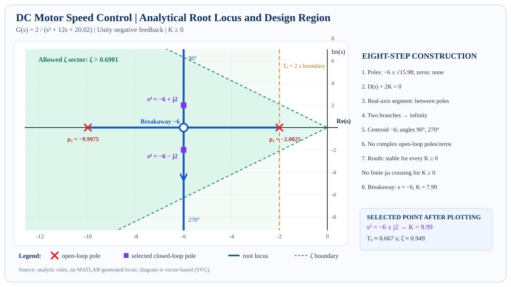
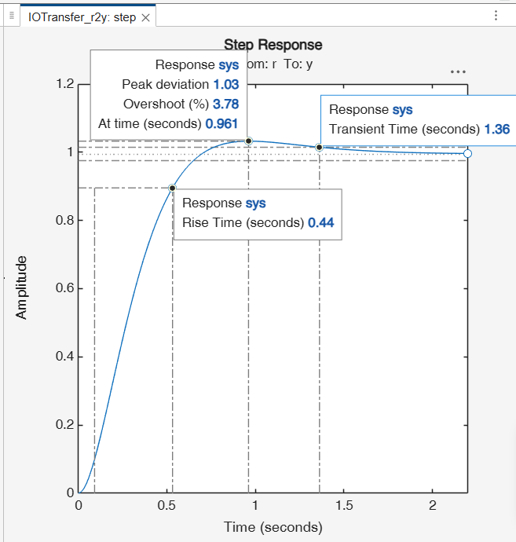
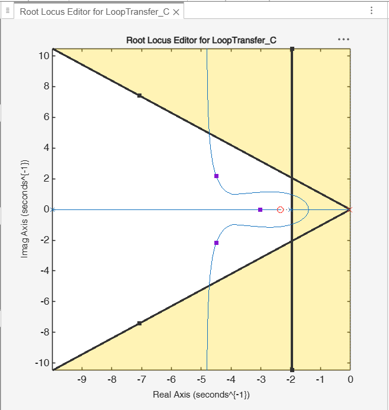
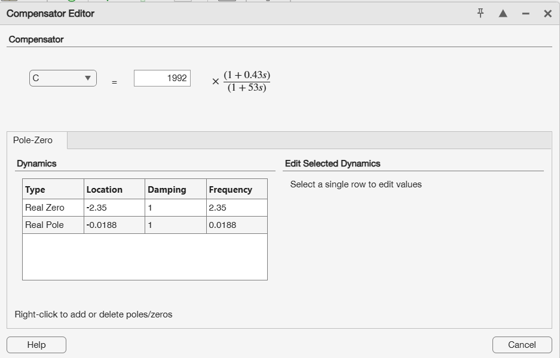
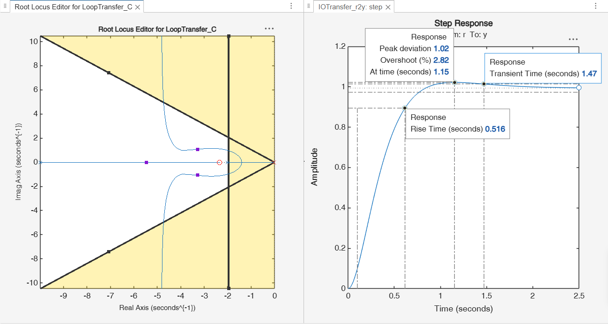

# DC Motor Speed Control — Root Locus and Analytical Lag Compensator

> **Study scope:** continuous-time, unity-negative-feedback DC motor speed control. This section documents an analytical Lag-compensator design, independent MATLAB verification, and a separate interactive Root Locus demonstration. The plant and its physical derivation are covered in `../../System/Modeling/`, and the open-loop response in `../../System/Analysis/`.

## 1. Objective and design requirements

We use Root Locus to understand how controller gain, poles, and zeros affect **closed-loop pole locations**. We then design a Lag compensator **by equations**, not by trying arbitrary values in MATLAB.

| Requirement for a 1 rad/s speed-reference step | Limit |
| :-- | :-- |
| Settling time (2% band) | Less than 2 seconds |
| Maximum overshoot | Less than 5% |
| Steady-state tracking error | Less than 1% |
| Rise time (10–90%) | Measured for comparison; no prescribed limit |

The **input to the open-loop plant** is motor voltage, but the **closed-loop unit step** in this section is a **speed reference**. These must not be confused.

## 2. DC motor and unity feedback

The normalized transfer function from armature voltage to angular speed is:

```math
P(s)=\frac{2}{s^{2}+12s+20.02}
```

For controller `C(s)` and unity negative feedback:

```math
L(s)=C(s)P(s)
```

```math
T(s)=\frac{L(s)}{1+L(s)}
```

The **open-loop function `L(s)`** determines the Root Locus, while `T(s)` gives the **closed-loop response** to the reference.

## 3. Root Locus: essential interpretation

- Root-locus branches **begin at the open-loop poles** of `L(s)` and **terminate at its finite zeros or at infinity** as a positive scalar gain varies.
- **Crosses (×)**: open-loop poles. **Circles (○)**: open-loop zeros. **Purple squares** in Control System Designer: closed-loop poles at the currently selected loop gain.
- The colored/shaded areas in the editor represent **excluded design regions**, not extra poles.
- Dragging a purple square along a locus changes the **scalar loop gain** for the current compensator structure. To change the compensator pole/zero positions, use **Compensator Editor**.

For a second-order system without closed-loop zeros, the standard design approximations are:

```math
T_s\approx\frac{4}{\zeta\omega_n}
```

```math
M_p\approx 100e^{-\pi\zeta/\sqrt{1-\zeta^2}}\;\%
```

The specified 2-second settling-time limit gives an approximate boundary at `Re(s) = -2`; overshoot below 5% corresponds to damping ratio above approximately `0.6901`. These **second-order boundaries do not guarantee** third-order or zero-containing responses satisfy the specifications: verify the complete step response.

### 3.1 Construct design boundaries before drawing Root Locus

The required **1 rad/s reference-step** performance is settling time $T_s<2$ s (2% criterion) and maximum overshoot $M_p<5\%$. Under the *standard second-order approximations*, these define a **region**, rather than one automatically chosen pole pair.

**Damping ratio boundary.** From the overshoot equation, at $M_p=0.05$:

```math
M_p=e^{-\pi\zeta/\sqrt{1-\zeta^2}},\qquad
\zeta_{\min}=\frac{-\ln(0.05)}{\sqrt{\pi^2+[\ln(0.05)]^2}}\approx0.6901
```

The two constant-damping rays begin at the origin and make $\theta=\cos^{-1}(0.6901)\approx46.36^\circ$ above and below the **negative real axis**. Draw these rays and retain the sector *between* them.

**Settling-time boundary.**

```math
T_s\approx\frac{4}{\zeta\omega_n}<2
\quad\Longrightarrow\quad \zeta\omega_n>2
\quad\Longrightarrow\quad\operatorname{Re}(s)<-2
```

Draw a vertical line at $s=-2$, retaining its **left** side. The allowable region is the **intersection** of this half-plane and the damping sector.

A constant natural frequency would make a circle centered at the origin because $\omega_n=|s|=\sqrt{\sigma^2+\omega_d^2}$, but the original requirements do **not** specify an independent constant $\omega_n$. Do not invent an extra circle-shaped pass/fail boundary.

### 3.2 Construct the uncompensated Root Locus by all eight standard rules

Use the *positive variable gain* $K\ge0$, unity negative feedback $H(s)=1$, and the exact plant:

```math
G(s)=\frac{2}{s^2+12s+20.02}
```

**Step 1 — Find open-loop poles and zeros.**

```math
s^2+12s+20.02=0\quad\Longrightarrow\quad
p_{1,2}=-6\pm\sqrt{15.98}
```

Hence $p_1=-2.002500781738663\ldots$, $p_2=-9.997499218261337\ldots$. There are **no finite zeros**. The exact symbolic roots are preserved instead of rounding them to $-2,-10$.

**Step 2 — Characteristic equation.**

```math
1+KG(s)H(s)=0
\quad\Longrightarrow\quad
D(s,K)=s^2+12s+20.02+2K=0
```

The factors $2K$ and $20.02$ are essential; using $K$ alone or $20$ would analyze a different plant.

**Step 3 — Plot poles and zeros and identify the real-axis locus.** Mark crosses at both real poles. The **odd-number rule** states that a real point is on the positive-gain locus if an odd number of real open-loop poles and zeros lie **to its right**.

| Real-axis interval | Number to its right | Root Locus? |
| :-- | --: | :-- |
| $s<-9.9974992$ | 2 | No |
| $-9.9974992<s<-2.0025008$ | 1 | **Yes** |
| $s>-2.0025008$ | 0 | No |

Thus the pole near $-10$ travels **right toward the other pole**, not left toward negative infinity. The pole near $-2$ travels left. They approach one another.

**Step 4 — Count branches.** There are $n=2$ poles and $m=0$ finite zeros, hence **two branches**, both ending at infinity.

**Step 5 — Calculate asymptote angles and centroid.** Index $i=1,2,\ldots,n-m$:

```math
\theta_i=\frac{180^\circ+360^\circ(i-1)}{n-m}
```

With $n-m=2$, $\theta_1=90^\circ$ and $\theta_2=270^\circ$ (or $-90^\circ$). The centroid is:

```math
\sigma_a=\frac{\sum p_i-\sum z_i}{n-m}
=\frac{-12-0}{2}=-6
```

The centroid is **exactly** $-6$, not a rounded result.

**Step 6 — Angles of departure and arrival.** There are no non-real **open-loop poles** or finite zeros requiring separate complex departure/arrival-angle formulas. The real-axis rule fixes initial movement; the two branches separate upward and downward at the breakaway point.

**Step 7 — Routh–Hurwitz and imaginary-axis intersection.** The Routh array of $D(s,K)$ is:

| Row | Column 1 | Column 2 |
| :-- | :-- | :-- |
| $s^2$ | $1$ | $20.02+2K$ |
| $s^1$ | $12$ | $0$ |
| $s^0$ | $20.02+2K$ | — |

All first-column entries are positive for $K>-10.01$. Therefore **every positive gain is stable** in this ideal second-order model.

The **auxiliary polynomial** method remembered from Routh applies when an **entire row becomes zero**: use the entries in the row just above to form a polynomial, for example $s^2+20=0\Rightarrow s=\pm j\sqrt{20}$. That situation **does not occur here**, since the $s^1$ row is $12$, not zero. Taking the top row $s^2+(20.02+2K)=0$ as an auxiliary polynomial in this case would be incorrect.

Check imaginary-axis crossings directly using $s=j\omega$:

```math
-\omega^2+12j\omega+20.02+2K=0
```

Separate real and imaginary parts:

```math
-\omega^2+20.02+2K=0,\qquad12\omega=0
```

Thus $\omega=0$, and $K=-10.01$, which is **outside $K\ge0$**. There is no finite imaginary-axis crossing on the positive-gain Root Locus. The branches do not loop back or cross the imaginary axis.

**Step 8 — Breakaway point and its gain.** Solve the characteristic equation for gain and differentiate:

```math
K(s)=-\frac{s^2+12s+20.02}{2},
\qquad \frac{dK}{ds}=-(s+6)=0
```

Therefore the candidate is $s_b=-6$. It lies **between the two real poles**, on the valid real-axis locus, so it is the actual breakaway. Its gain is:

```math
K_b=-\frac{36-72+20.02}{2}=7.99
```

The exact closed-loop pole trajectory is:

```math
s(K)=-6\pm\sqrt{15.98-2K}
```

For $0\le K<7.99$, poles move toward one another **on the real axis**. At $K=7.99$, they merge at $-6$; for $K>7.99$, they are $s=-6\pm j\sqrt{2K-15.98}$. Therefore both complex branches lie **exactly** on the vertical line $\operatorname{Re}(s)=-6$.

### 3.3 Complete analytical figure: root locus and permitted region



**Figure interpretation.** Red crosses = open-loop poles; solid blue paths = the positive-gain locus; blue open circle = breakaway at $-6$, $K=7.99$; dashed blue line = asymptotes at $90^\circ/270^\circ$; green boundary rays = $\zeta=0.6901$; orange vertical boundary = settling-time limit $\operatorname{Re}(s)=-2$. Purple squares show a subsequently chosen pair of closed-loop poles. The diagram is calculated from the equations above, **not generated using MATLAB's automated root-locus plotting**.

### 3.4 Pick desired poles *after* the region and root locus are drawn

Our selected pole pair must be located **simultaneously** on the Root Locus and in the permitted transient region. On the complex branches:

```math
s=-6\pm j\omega_d,\qquad
\zeta=\frac{6}{\sqrt{36+\omega_d^2}}
```

The settling condition is met since $-6<-2$; the damping boundary requires $\zeta>0.6901$, giving $0<\omega_d\lesssim6.29$. This defines an allowable **range**, not a uniquely required point. We select $\omega_d=2$, and hence:

```math
s_d=-6\pm j2,\quad
\omega_n=\sqrt{40}\approx6.3249,\quad
\zeta=\frac6{\sqrt{40}}\approx0.9487
```

**Angle condition:** $1+KG(s)H(s)=0$ requires $KG(s_d)H(s_d)=-1$. For real positive $K$, the phase of $G(s_d)H(s_d)$ must equal an **odd multiple of $180^\circ$**:

```math
\angle G(s_d)H(s_d)=(2q+1)180^\circ
```

Angles are measured from the **positive real axis**. Compute the vectors *from each pole to the proposed point*. For the pole near $-9.9975$, $\theta_1=\tan^{-1}(2/3.9974992)\approx26.58^\circ$. For the pole near $-2.0025$, the vector lies in the **second quadrant**, so $\theta_2=180^\circ-\tan^{-1}(2/3.9974992)\approx153.42^\circ$. Since there are no zeros:

```math
\angle G(s_d)=\sum\angle(s_d-z_i)-\sum\angle(s_d-p_i)
=-(26.58^\circ+153.42^\circ)=-180^\circ
```

Our point is on the positive-gain locus.

**Magnitude condition:** once the angle condition is satisfied,

```math
K=\frac{1}{|G(s_d)H(s_d)|}
=\frac{|s_d^2+12s_d+20.02|}{2}
```

Substituting $s_d=-6+j2$ yields $s_d^2+12s_d+20.02=-19.98+0j$, so:

```math
K=\frac{19.98}{2}=9.99
```

Do **not** arbitrarily throw away an imaginary part to force $K$ real; the **angle condition** is why the proposed point yields a real positive gain.

The second-order transient indicators are $T_s\approx4/6=0.667$ s, $\zeta\approx0.9487$, and $M_p\approx0.0081\%$. These support transient-region feasibility, while the actual tracking error remains to be evaluated next.

### 3.5 Separate transient feasibility from steady-state tracking

The hand-drawn Root Locus **does pass through the permitted transient region**. Therefore a proportional gain can meet the *transient pole-placement* constraints for this motor. But that does **not** establish full specification compliance.

Section 4 now performs the independent **steady-state tracking-error test**. At $K=9.99$, $e_{ss}\approx50.05\%$. Achieving error below $1\%$ with P gain alone requires $K>990.99$, which drives the damping too low and violates the overshoot criterion. **The system is still stable for all $K\ge0$**; its failure is transient accuracy versus steady-state accuracy, **not instability**. Physical voltage limits and saturation are real implementation concerns but were not checked in this ideal model.

---

## 4. Why proportional gain is not enough

For a proportional controller `C(s) = K`, the closed-loop transfer function is:

```math
T_P(s)=\frac{2K}{s^2+12s+20.02+2K}
```

With the desired baseline poles near `-6 ± j2`, coefficient matching gives:

```math
(s+6-j2)(s+6+j2)=s^2+12s+40
```

```math
20.02+2K=40\quad\Rightarrow\quad K=9.99
```

Its steady-state tracking error for a unit speed-reference step is:

```math
e_{ss,P}=\frac{20.02}{20.02+2K}
```

At `K = 9.99`, the error is `50.05%` approximately. The settling-time and overshoot objectives can be met, but accuracy is not. Increasing only the P gain enough to meet `e_ss < 1%` requires `K > 990.99`, incompatible with the overshoot limit in this specific second-order system.

**Engineering decision:** improve low-frequency tracking accuracy with an added dynamic compensator rather than increasing proportional gain alone.

## 5. Lead versus Lag (brief design rationale)

| Feature | Lead compensator | Lag compensator |
| :-- | :-- | :-- |
| Pole/zero order on negative real axis | Pole farther left than zero | Pole closer to origin than zero |
| Common purpose | Improve transient response, bandwidth, and/or phase margin | Improve low-frequency accuracy, usually with bandwidth/phase trade-offs |
| Need in this example | Not demonstrated by the transient-response criteria | Appropriate for the large steady-state error |

**Caution:** We did not independently measure a phase margin for the uncompensated design here. We therefore do **not** claim that it is already excellent. Lag may also influence phase margin; its full response must be checked.

## 6. Analytical Lag design — derive pole, zero, and gain

### 6.1 Define the controller without guessing its parameters

The Lag structure is:

```math
C_{lag}(s)=K\frac{s+z}{s+p},\qquad K>0,\quad z>p>0
```

Its **zero** is located at `-z`, and its **pole** at `-p`. There are three unknowns: `K`, `z`, and `p`.

We use design targets *inside* the original limits, providing a margin relative to the maximum permitted settling time, overshoot, and error:

| Target | Value | Reason |
| :-- | --: | :-- |
| Damping ratio, `zeta` | 0.90 | Higher than the minimum for 5% overshoot |
| Selected complex-pair real decay rate, `sigma = zeta*wn` | 4.50 rad/s | Faster than the approximate 2 rad/s boundary |
| Target steady-state step tracking error | 0.005 (0.50%) | Inside the 1% limit |

These are **explicit design choices**, not parameters uniquely forced by the inequality requirements. The equations below then determine `p`, `K`, and `z` without trial-and-error tuning.

### 6.2 Calculate the desired complex pair

```math
\omega_n=\frac{\sigma}{\zeta}=\frac{4.5}{0.9}=5\ \mathrm{rad/s}
```

```math
\omega_d=\omega_n\sqrt{1-\zeta^2}=2.17945\ \mathrm{rad/s}
```

```math
s_{1,2}=-4.5\pm j2.17945
```

Therefore the desired **second-order factor** is:

```math
s^2+9s+25
```

We do **not assume that a third pole is negligible or that this selected pair will dominate the full response**. Represent the third closed-loop pole by `-a`, and solve for it with the Lag parameters:

```math
D_{desired}(s)=(s^2+9s+25)(s+a)
```

```math
D_{desired}(s)=s^3+(9+a)s^2+(25+9a)s+25a
```

### 6.3 Form the actual closed-loop characteristic polynomial

```math
L(s)=\frac{2K(s+z)}{(s+p)(s^2+12s+20.02)}
```

The characteristic equation `1 + L(s) = 0` becomes:

```math
D_{actual}(s)=(s+p)(s^2+12s+20.02)+2K(s+z)
```

Expanding:

```math
D_{actual}(s)=s^3+(12+p)s^2+(20.02+12p+2K)s+(20.02p+2Kz)
```

### 6.4 Match coefficients

Matching `D_actual(s)` with `D_desired(s)` gives **three exact equations**:

```math
12+p=9+a
```

```math
20.02+12p+2K=25+9a
```

```math
20.02p+2Kz=25a
```

From the first equation:

```math
a=3+p
```

### 6.5 Use the steady-state error equation to calculate the Lag pole

For a unit speed-reference step and stable unity feedback:

```math
e_{ss}=\frac{1}{1+L(0)}
```

```math
L(0)=\frac{2Kz}{20.02p}
```

Thus:

```math
e_{ss}=\frac{20.02p}{20.02p+2Kz}
```

By coefficient matching, the denominator's constant term is `25a`, hence:

```math
0.005=\frac{20.02p}{25(3+p)}
```

```math
0.125(3+p)=20.02p
```

```math
p=\frac{0.375}{19.895}=0.018848957
```

The derived third-pole magnitude is:

```math
a=3+p=3.018848957
```

### 6.6 Calculate gain and zero

Using the coefficient of `s`:

```math
K=\frac{25+9a-20.02-12p}{2}=15.96172656
```

Using the constant term:

```math
z=\frac{25a-20.02p}{2K}=2.35231031
```

**Final analytical controller:**

```math
C_{lag}(s)=15.96172656\frac{s+2.35231031}{s+0.018848957}
```

The pole is indeed closer to the origin than the zero (`0 < p < z`), so this is a Lag network. The zero and pole are *not especially close together*, so this design differs from the traditional near-cancelling Lag rule of thumb. The full response, not only second-order approximations, must determine acceptability.

### 6.7 Full closed-loop model and poles

```math
T_{lag}(s)=\frac{31.92345313s+75.09386781}{s^3+12.01884896s^2+52.16964061s+75.47122393}
```

The resulting closed-loop poles are:

```math
s_{1,2}=-4.5\pm j2.17945,\qquad s_3=-3.01884896
```

**Important:** the third real pole is **slower** than the complex pair in its exponential decay rate; it cannot be neglected. This is why we evaluated the *full* third-order response, including the closed-loop zero.

## 7. Routh–Hurwitz stability check

For a third-order characteristic polynomial:

```math
D(s)=s^3+a_2s^2+a_1s+a_0
```

With positive coefficients, the Routh condition requires:

```math
a_2a_1>a_0
```

For our designed Lag system:

| Polynomial coefficient | Value |
| :-- | --: |
| `a2` | 12.01884896 |
| `a1` | 52.16964061 |
| `a0` | 75.47122393 |

Its Routh array is:

| Row | Column 1 | Column 2 |
| :-- | --: | --: |
| `s^3` | 1 | 52.169641 |
| `s^2` | 12.018849 | 75.471224 |
| `s^1` | 45.890235 | 0 |
| `s^0` | 75.471224 | 0 |

All first-column elements are positive. The closed-loop system is asymptotically stable for the **idealized linear model**.

## 8. MATLAB verification against the design limits

The following are **actual MATLAB outputs supplied from the project run**, rather than claimed output from an execution in this repository authoring environment.

| Metric | Analytical expected | MATLAB measured | Requirement | Result |
| :-- | --: | --: | :-- | :-- |
| Rise time (10–90%) | ~0.440 s | **0.4403 s** | Not specified | Recorded |
| Settling time (2% band) | ~1.362 s | **1.3623 s** | < 2 s | PASS |
| Overshoot | ~3.78% | **3.7822%** | < 5% | PASS |
| Steady-state step error | 0.50% | **0.5000%** | < 1% | PASS |
| Peak time | ~0.961 s | **0.9610 s** | Not specified | Recorded |
| Peak output | ~1.0326 rad/s | **1.0326 rad/s** | Not specified | Recorded |

MATLAB reported poles `-4.5000 ± 2.1794i` and `-3.0188`, matching the analytical characteristic polynomial. The steady-state value is `0.995` rad/s for a `1 rad/s` speed-reference step.

### Figure 1 — Annotated lag-compensated step response



The annotated plot illustrates both the desired speed tracking and the overshoot and transient time obtained by MATLAB. The reference is a **speed command**, not a 1 V voltage command.

### Figure 2 — Root locus and graphical design regions



The purple markers indicate **the current closed-loop poles**; the crosses and circles denote **open-loop poles and zeros of the compensated loop**. Shading represents excluded pole regions for the displayed requirements. Pole-region compliance is useful but **does not alone establish** the performance of the complete third-order system.

### Figure 3 — Lag Compensator Editor



The editor presents the same controller in **time-constant form**:

```math
C(s)\approx1992\,\frac{1+0.43s}{1+53s}
```

The displayed factor `1992` is the **DC-normalized coefficient**, not the `K = 15.9617` used in the pole-zero-gain form. The displayed parameters are rounded, explaining small visual differences.

### Figure 4 — Interactive gain tuning (separate exploratory example)



When closed-loop markers are dragged along existing root-locus branches, Control System Designer changes the **loop gain** and immediately updates the response. In the separate interactive screenshot the displayed response has **rise time ~0.516 s, settling time ~1.47 s, and overshoot ~2.82%**. These are **not** the baseline analytical controller's numbers; the screenshot is included as a demonstration of design trade-offs and visualization, not as a replacement for the derived controller.

## 9. Using Control System Designer effectively

Run `src/02_analytical_lag_design.m` to load the designed compensator:

```matlab
controlSystemDesigner('rlocus',P_motor,C_lag);
```

1. **Compensator Editor:** inspect the calculated gain, real zero, and real pole. Display format may be time-constant or zero-pole-gain; they are mathematically equivalent.
2. **Root Locus Editor:** inspect closed-loop poles (purple squares), loop poles (crosses), zeros (circles), and excluded design regions.
3. **Step Response:** show Rise Time, Settling/Transient Time, Peak Response, and Steady State using the plot's **Characteristics** menu.
4. **Design Requirements:** add limits for **overshoot < 5%** and **settling time < 2 s**. Treat the root-locus regions as design guidance; verify the actual response separately.
5. **Interactive Tuning:** dragging closed-loop poles modifies the gain for the selected compensator structure. Editing the Lag pole or zero changes the **shape** of the root locus; keep such experiments distinct from the documented analytical design.
6. **Save Session:** save the MATLAB Control System Designer session under `sessions/` if you want to reopen the exact GUI layout later. No unverified session file has been generated here.

For reproducibility, the scripts under `src/` remain the **source of truth**. The GUI screenshots are documentary evidence of the runs, not executable source.

## 10. Engineering conclusions and limitations

**Outcome:** the analytically derived Lag network meets the requested settling time, maximum overshoot, and steady-state tracking error for the **continuous-time linear motor model**.

**Key lessons:**

- We calculated **pole, zero, and gain**, starting from documented design targets and matching the **full third-order** characteristic polynomial.
- Routh–Hurwitz confirmed model stability and MATLAB verified the complete time response.
- A third pole closer to the imaginary axis can matter even when the dominant complex pair is in an acceptable Root Locus region.
- Control System Designer supports both **visual verification** and **optional interactive exploration**.
- The requirements are inequalities, so they do **not specify a unique compensator**. Our chosen targets make the design reproducible but do not prove optimality.
- We have **not** verified supply voltage/current limits, actuator saturation, model uncertainty, disturbances, or hardware operation. No measured phase-margin claim is made in this section.

## 11. Source files and references

| File | Use |
| :-- | :-- |
| [`src/01_uncompensated_root_locus.m`](src/01_uncompensated_root_locus.m) | Baseline proportional pole-placement and step error |
| [`src/02_analytical_lag_design.m`](src/02_analytical_lag_design.m) | Derive `p`, `K`, `z`; examine poles, full step response, and launch designer |
| [`src/03_compare_P_and_Lag.m`](src/03_compare_P_and_Lag.m) | Compare baseline P controller against analytical Lag using Linear System Analyzer |
| [`figures/`](figures/) | Screenshots from the project MATLAB run |
| [`sessions/README.md`](sessions/README.md) | Instructions for saving a real MATLAB designer session |

Primary learning reference: [University of Michigan — Control Tutorials for MATLAB and Simulink (CTMS): DC Motor Speed, Root Locus](https://ctms.engin.umich.edu/CTMS/index.php?example=MotorSpeed&section=ControlRootLocus).

Tool reference: [MathWorks — Root Locus Design](https://www.mathworks.com/help/control/ug/root-locus-design.html), [Compensator Dynamics](https://www.mathworks.com/help/control/ug/edit-compensator-dynamics.html), and [Design Requirements](https://www.mathworks.com/help/control/ug/design-requirements.html).

The mathematical design and analysis presented here are our own worked extension of the tutorial. Screenshots labeled as MATLAB results were supplied from the project's actual MATLAB run. No hardware verification is claimed.
