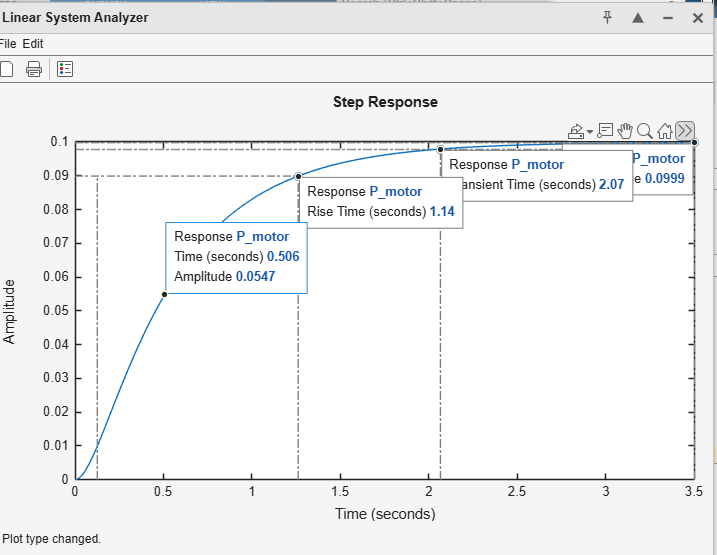
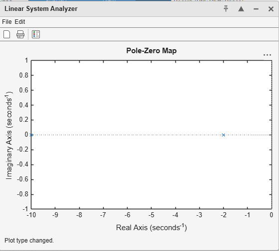
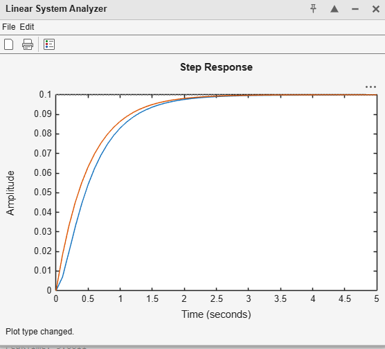
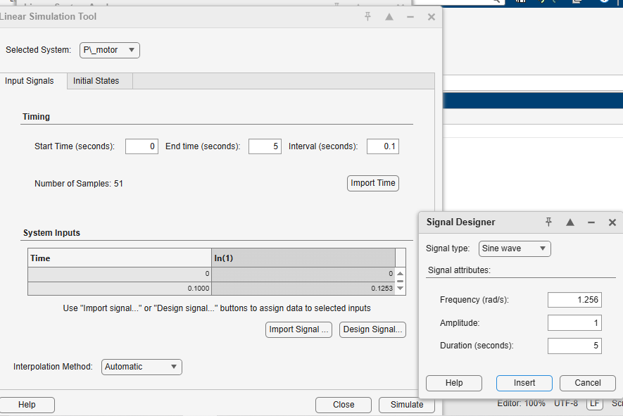
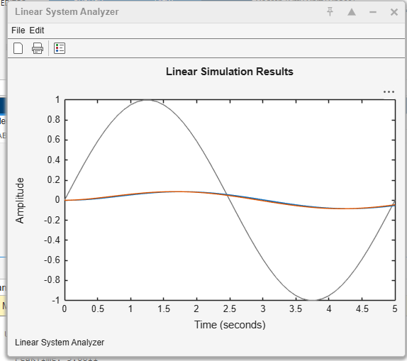
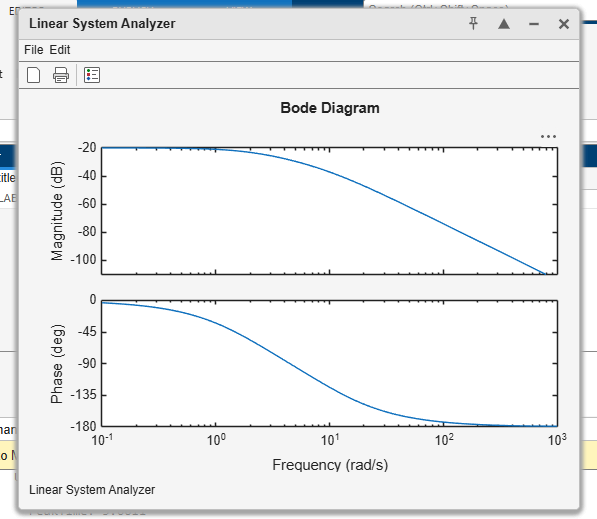

# DC Motor Speed — System Analysis

> **Understand the open-loop motor before designing its controller:** examine the step response, poles, dominant-pole approximation, sinusoidal response, and frequency response using MATLAB's **Linear System Analyzer**.

**Stage:** System / Analysis · **Plant:** continuous-time DC motor (speed output) · **Primary MATLAB tool:** `linearSystemAnalyzer` · **Required toolbox:** Control System Toolbox.

**Previous stage:** [System Modeling](../Modeling/README.md) — physical circuit, governing equations, transfer function, and state space.  
**Next stage:** Controller design — PID, root locus, frequency-domain control, and state-space control.

**Scope:** This section analyzes the **uncompensated plant**. No PID gains are selected, and no closed-loop performance is claimed. The textbook steady-state error constants are treated separately under an **explicit unity-feedback assumption**.

---

## 1. Start with the open-loop motor model

The previous section derived the voltage-to-speed transfer function:

```math
P(s)=\frac{\Omega(s)}{V(s)}
=\frac{K_t}{(Js+b)(Ls+R)+K_tK_e}
```

Using the same physical parameters:

| Parameter | Value | Parameter | Value |
|:--|--:|:--|--:|
| Rotor inertia, $J$ | $0.01$ | Viscous friction, $b$ | $0.1$ |
| Torque constant, $K_t$ | $0.01$ | Back-EMF constant, $K_e$ | $0.01$ |
| Resistance, $R$ | $1\ \Omega$ | Inductance, $L$ | $0.5\ \mathrm{H}$ |

Therefore:

```math
P(s)=\frac{0.01}{0.005s^2+0.06s+0.1001}
```

The **input** is armature voltage $V(t)$ in volts, and the **output** is rotor angular speed $\omega(t)$ in rad/s.

### Design targets (for the controller we will build later)

| Criterion | Required performance |
|:--|:--|
| Command | Unit step in **desired speed**, $1\ \mathrm{rad/s}$ |
| Settling time | Less than $2\ \mathrm{s}$ |
| Overshoot | Less than $5\%$ |
| Steady-state tracking error | Less than $1\%$ |

> **Important:** In this section, a **1-V step into the plant** is an input-voltage test. It is **not** the same experiment as tracking a **1-rad/s speed reference** in a controlled feedback system.

---

## 2. Open-loop step response: how fast does the motor respond?

### 2.1 Apply a 1-V step

We first apply $V(t)=1\ \mathrm{V}$ for $t\geq0$ and inspect the output speed.

MATLAB command:

```matlab
linearSystemAnalyzer('step', P_motor, 0:0.1:5);
```

The vector `0:0.1:5` requests a response from 0 to 5 seconds with a 0.1-second time step.

In the graph, use **Right click > Characteristics > Settling Time / Steady State / Peak Response** as available in your MATLAB version. For this project we read transient metrics directly from the **Linear System Analyzer annotations**, rather than calling `stepinfo`. The steady-state gain can also be calculated from $P(0)$, as shown below.

### 2.2 Read the results

| Open-loop measurement | Expected result | Interpretation |
|:--|--:|:--|
| Final speed at 1 V | $0.09990\ \mathrm{rad/s}$ | About $0.1\ \mathrm{rad/s}$ |
| Settling time (2% criterion) | $\approx 2.07\ \mathrm{s}$ | Slightly slower than the future 2-s design target |
| Overshoot | $0\%$ | The speed rises without overshooting its final value |
| Rise time (10–90%) | $\approx 1.14\ \mathrm{s}$ | Additional useful transient metric |

The steady speed follows from the transfer function's **DC gain**:

```math
\omega_{ss} = P(0)\times 1\ \mathrm{V}
=\frac{0.01}{0.1001}\times 1\ \mathrm{V}
\approx 0.09990\ \mathrm{rad/s}
```

**Engineering observation:** the motor settles at about $0.1\ \mathrm{rad/s}$ for a 1-V input and takes roughly 2.07 s to settle. These are **open-loop plant measurements**, not closed-loop reference-tracking results.



*Captured in MATLAB Linear System Analyzer: rise time 1.14 s, settling time 2.07 s, final value approximately 0.0999 rad/s. The additional time/amplitude cursor is not a separate performance metric.*

---

## 3. Steady-state errors: Step, Ramp, and Parabolic

In control theory, the classical **position, velocity, and acceleration error constants** are used to study *tracking error* in a **unity negative-feedback system**. A stand-alone plant has an input voltage and an output speed, but it does not have a reference-comparison signal $e=r-y$ by itself.

For this **separate textbook calculation only**, assume a hypothetical unity-feedback loop whose forward-path transfer function is $L(s)=P(s)$ (equivalent to choosing a unity proportional gain with consistent units). **No such controller is designed or tested in this stage.**

The loop has **Type 0**, because $P(s)$ has no pole at the origin.

### 3.1 Error constants

**Position error constant** (unit-step reference):

```math
K_{\mathrm{pos}}=\lim_{s\to0}L(s)=P(0)=0.0999001
```

**Velocity error constant** (unit-ramp reference):

```math
K_{\mathrm{vel}}=\lim_{s\to0}sL(s)=0
```

**Acceleration error constant** (unit-parabolic reference):

```math
K_{\mathrm{acc}}=\lim_{s\to0}s^2L(s)=0
```

### 3.2 Error table — hypothetical unity-feedback loop

| Reference input | Standard form | Formula | Steady-state error |
|:--|:--|:--|--:|
| Step | $r(t)=1$ | $1/(1+K_{\mathrm{pos}})$ | $0.90917$ ($90.92\%$ of the unit command) |
| Ramp | $r(t)=t$ | $1/K_{\mathrm{vel}}$ | $\infty$ |
| Parabolic | $r(t)=t^2/2$ | $1/K_{\mathrm{acc}}$ | $\infty$ |

**Why are Ramp and Parabolic errors infinite?** With no integrator in the assumed forward path, the feedback system cannot track inputs that grow continually while keeping a bounded tracking error.

> Do not confuse the hypothetical **90.92% unity-feedback tracking error** with the **0.09990-rad/s open-loop speed at 1 V**. They describe **different system configurations**. Also, the conventional third reference is **parabolic**, not hyperbolic.

The separate, simple MATLAB script [`src/steady_state_error_constants.m`](src/steady_state_error_constants.m) calculates these textbook error constants; it does not represent a controller design.

---

## 4. Pole-Zero Map: what determines the dynamics?

From the normalized plant transfer function:

```math
P(s)=\frac{2}{s^2+12s+20.02}
```

The poles are the roots of:

```math
s^2+12s+20.02=0
```

Numerically:

```math
p_1\approx-2.0025,\qquad p_2\approx-9.9975
```

(CTMS rounds these to $-2$ and $-10$.) There are **no finite zeros** in this transfer function.

In the Linear System Analyzer, right-click the plot and select **Plot Types > Pole/Zero**, or run:

```matlab
motor_poles = pole(P_motor)
motor_zeros = zero(P_motor)
```

**Interpretation:**

1. Both poles are in the **left-half plane**, so the open-loop linear motor model is stable.
2. Both poles are **real and negative**, consistent with a non-oscillatory step response for this motor.
3. The pole near $-2$ is the **dominant (slow) pole**. The pole near $-10$ corresponds to a faster-decaying mode.
4. The fast mode decays about **five times faster**; it still affects the initial transient and higher-frequency behavior.

**Pole-Zero Map captured in MATLAB:**



*The two × markers lie on the negative real axis near $-10$ and $-2$. The more precise pole values above were calculated from the model; the plot illustrates their locations.*

---

## 5. First-order approximation: can we simplify the motor?

Because the second pole is much faster, we can *try* approximating the original second-order motor by retaining the **dominant pole** and approximately matching the **DC gain**.

```math
P_{\mathrm{approx}}(s)=\frac{0.1}{0.5s+1}
```

This model has one pole at $s=-2$ and a DC gain of $0.1$, close to the original $P(0)\approx0.09990$.

In MATLAB:

```matlab
rP_motor = 0.1/(0.5*s+1)
linearSystemAnalyzer('step', P_motor, rP_motor, 0:0.1:5);
```

### 5.1 Predict settling time using the time constant

For a standard first-order system:

```math
T_s\approx4\tau\qquad\text{(2% settling criterion)}
```

Since the approximate model has $\tau=0.5\ \mathrm{s}$:

```math
T_{s,\mathrm{approx}}\approx4(0.5)=2\ \mathrm{s}
```

Compare the results:

| Model | Order | Approximate 2% settling time | Final speed at 1 V |
|:--|:--:|--:|--:|
| Original motor | Second | $2.07\ \mathrm{s}$ | $0.09990\ \mathrm{rad/s}$ |
| Reduced model | First | $2.00\ \mathrm{s}$ | $0.10000\ \mathrm{rad/s}$ |

### 5.2 What does the comparison tell us?

The **dominant pole** explains most of the slow response; both models approach nearly the same final speed. However, the original second-order response initially has **zero slope**, while the first-order approximation starts with a nonzero slope. The ignored pole is not truly absent from the physical motor.

**Conclusion:** the first-order model is a **useful approximation** for some response calculations, not an exact replacement at every time or frequency.



*Captured in MATLAB: the two step responses are close, with their main difference during the initial transient.*

---

## 6. Response to other inputs: sinusoidal voltage

A step is only one possible applied voltage. To study time-varying behavior, apply a sinusoidal voltage to **both** models:

```math
V(t)=A\sin(2\pi ft)
```

For the CTMS example, $A=1\ \mathrm{V}$ and $f=0.2\ \mathrm{Hz}$:

```math
V(t)=\sin(0.4\pi t)\ \mathrm{V}
```

Its angular frequency and period are:

```math
\omega_{\mathrm{input}}=2\pi f\approx1.2566\ \mathrm{rad/s},\qquad
T=\frac{1}{f}=5\ \mathrm{s}
```

### 6.1 Simulation settings

| Setting | Value |
|:--|--:|
| Start time | 0 s |
| End time | 5 s |
| Sampling interval | 0.1 s |
| Input signal | Sine wave |
| Amplitude | 1 V |
| Frequency | **0.2 Hz** = **1.2566 rad/s** |

**MATLAB GUI method:** in Linear System Analyzer select **Plot Types > Linear Simulation**. In the signal designer choose **Sine wave** and use the values above. Pay attention to your version's frequency unit: if the field says **rad/s**, enter **1.2566**; if it says **Hz**, enter **0.2**.

**Direct MATLAB method (included in the script):**

```matlab
t = 0:0.1:5;
f = 0.2;
u = sin(2*pi*f*t);
linearSystemAnalyzer('lsim', P_motor, rP_motor, u, t);
```

### 6.2 What are we looking for?

- **Magnitude response:** the motor's output speed is much smaller numerically than the 1-V input because the plant gain is small (voltage and speed also have *different units*).
- **Phase lag:** the output speed responds later in the sinusoidal cycle than the applied voltage.
- **Model comparison:** the reduced model can track the original response closely at low frequencies, but differences appear as frequency increases or during the initial transient.
- **Frequency dependence:** different input frequencies produce different output amplitudes and phase shifts. This motivates the Bode diagram.

For reference, the full motor's **steady-state sinusoidal** output at $f=0.2\ \mathrm{Hz}$ has an amplitude of approximately $0.084\ \mathrm{rad/s}$ and a phase of about $-39.3^\circ$ relative to the voltage. The first 5-second plot also includes the **initial transient**, so do not read an exact steady-state phase directly from its first peak.

**Input configuration captured in MATLAB:**



**Observed simulation:**



*MATLAB comparison for the same 1-V, 0.2-Hz sine input: the large gray curve is the **input voltage**, the blue curve is the **original second-order motor speed**, and the orange curve is the **first-order approximation**. The two speed responses nearly overlap but are not identical. Voltage and speed use different physical units, even though the analyzer displays them on one common amplitude axis.*

---

## 7. Frequency-domain view: Bode plot

The Bode diagram plots the plant's **magnitude** and **phase** over a range of frequencies, rather than at the single sinusoidal frequency used in Section 6.

In MATLAB:

```matlab
linearSystemAnalyzer('bode', P_motor);
```

The analyzer can also display **Impulse**, **Nyquist**, **Nichols**, and other response plots through the plot-type menu. For this study, we focus on the **Step**, **Pole/Zero**, **Linear Simulation**, and **Bode** views; the **Impulse Response** is an optional extra.

### What about Gain Margin and Phase Margin?

These are stability margins for an **open-loop transfer function of a particular feedback loop**, often $L(s)=C(s)P(s)$, with a specified negative-feedback structure. Their interpretation depends on the loop being analyzed.

Our plant $P(s)$ has $|P(0)|\approx0.0999$ (about $-20\ \mathrm{dB}$), and its gain decreases with frequency. Thus **$P(s)$ never crosses 0 dB**, so a conventional **Phase Margin at gain crossover cannot be defined** for this uncompensated, unity-gain loop. The ideal plant also has no finite $-180^\circ$ phase crossing. Do **not** invent finite gain/phase margin values from this Bode plot.

We will revisit **Gain Margin, Phase Margin, and crossover frequencies** when we define a controller and a specific loop transfer function in the **Control** section.



*Captured in MATLAB: the magnitude is about −20 dB at low frequency and decreases; the phase approaches −180° at high frequency.*

---

## 8. MATLAB files and how to reproduce this section

| File | Purpose |
|:--|:--|
| [`src/dc_motor_analysis.m`](src/dc_motor_analysis.m) | Five short MATLAB sections: plant, step, poles/approximation, sine wave, and Bode |
| [`src/steady_state_error_constants.m`](src/steady_state_error_constants.m) | Separate textbook Step/Ramp/Parabolic tracking-error calculation **under unity feedback** |
| [`figures/README.md`](figures/README.md) | Screenshot checklist and the exact requested filenames |

Run `dc_motor_analysis.m` in MATLAB with **Control System Toolbox** installed. Run the sections individually with **Run Section** if you want to inspect one result at a time. Values without a semicolon are displayed directly in the **Command Window**; no `disp`, `fprintf`, `assert`, or automatic tuning are used.

**Status:** Screenshots in this document were supplied from the user’s MATLAB session. MATLAB has **not** been executed in this preparation environment. The Pole-Zero Map and two-model sinusoidal comparison are now included; numerical pole positions come from the model.

### MATLAB screenshots in this repository

- ✅ Open-loop Step Response with characteristic annotations
- ✅ Pole-Zero Map with two negative real poles
- ✅ Original vs. First-Order Step Response
- ✅ Sinusoidal Signal Designer settings (1.256 rad/s = 0.2 Hz)
- ✅ Sinusoidal Response — original motor versus first-order approximation
- ✅ Bode magnitude and phase

**Optional:** Impulse Response. See [`figures/README.md`](figures/README.md) for filenames.

---

## 9. Engineering takeaways

- The original motor is a **stable second-order LTI system** with two real, negative poles and no finite zeros.
- For **1 V**, its final speed is about **0.1 rad/s**, and its 2% settling time is about **2.07 s**.
- The pole near **$-2$** dominates the slow dynamics, allowing a **first-order approximation** with $\tau=0.5$ s and an estimated settling time of **2 s**.
- Different voltage inputs reveal different aspects of the same plant: **step** for transients, **sinusoids** for gain/phase behavior, and **Bode** for the full frequency range.
- The existing open-loop plant alone does **not** establish the final tracking error of the future controlled system. Controller design is the next stage.

## References

- [CTMS (University of Michigan) — DC Motor Speed: System Analysis](https://ctms.engin.umich.edu/CTMS/index.php?example=MotorSpeed&section=SystemAnalysis)
- [CTMS — DC Motor Speed: System Modeling](https://ctms.engin.umich.edu/CTMS/index.php?example=MotorSpeed&section=SystemModeling)
- [MathWorks — Linear System Analyzer](https://www.mathworks.com/help/control/ref/linearsystemanalyzer-app.html)
- [MathWorks — Gain and Phase Margins](https://www.mathworks.com/help/control/ref/dynamicsystem.margin.html)

*Reference equations and learning objectives follow CTMS; the explanations, workflow, and MATLAB scripts in this repository are organized as this project's own study notes.*
