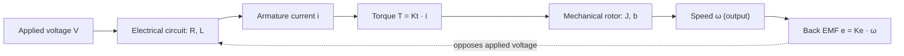

# DC Motor Speed — System Modeling

> **From the armature circuit and rotor dynamics to two equivalent mathematical models:** a **Transfer Function** and a **State-Space Representation**.

**Study:** DC motor speed (not angular position) · **Model:** continuous-time, linear, armature-controlled DC motor · **MATLAB tools:** `tf`, `ss`, `freqresp` (Control System Toolbox).

**Goal of this section:** derive the model from physics and verify that both representations describe the same input–output system. **Controller tuning, step-response plots, and performance requirements are intentionally deferred** to later sections.

## 1. Physical setup: what are we modeling?


*Figure 1. Original circuit/rotor diagram from the [CTMS DC Motor Speed: System Modeling tutorial](https://ctms.engin.umich.edu/CTMS/index.php?example=MotorSpeed&section=SystemModeling); cropped from the study reference screenshot without redrawing. Attribution and license: [CTMS / CC BY-SA 4.0](#source-and-attribution).*

We first identify the **input** and **output**, then study the electrical and mechanical parts separately. The motor current and angular speed connect the two parts.

| Role | Symbol | Meaning |
|:--|:--|:--|
| **Input** | $V(t)$ | Voltage applied to the armature (volts) |
| **Output** | $\omega(t)=\dot\theta(t)$ | Rotor angular speed (rad/s) |
| Internal variable / state | $i(t)$ | Armature current (A) |
| Electromechanical coupling | $T(t)$ | Electromagnetic torque (N·m) |
| Electromechanical coupling | $e(t)$ | **Back EMF** induced by rotation (V) |

> **Notation check:** the applied input is **$V$**, while **$e$** in the circuit is the *back electromotive force*, not the supply voltage. Also, $\theta$ is **position**, while $\omega=\dot\theta$ is **speed**.

### Physical parameters

| Symbol | Physical meaning | CTMS example value |
|:--:|:--|--:|
| $J$ | Rotor moment of inertia | $0.01\ \mathrm{kg\,m^2}$ |
| $b$ | Viscous friction coefficient | $0.1\ \mathrm{N\,m\,s/rad}$ |
| $K_e$ | Back-EMF constant | $0.01\ \mathrm{V/(rad/s)}$ |
| $K_t$ | Torque constant | $0.01\ \mathrm{N\,m/A}$ |
| $R$ | Armature resistance | $1\ \Omega$ |
| $L$ | Armature inductance | $0.5\ \mathrm{H}$ |

**Assumptions:** rigid shaft/rotor; constant magnetic field; linear back-EMF and torque relationships; viscous friction proportional to speed; no external load torque in this example. Transfer-function derivation assumes zero initial conditions. In the CTMS example, $K_t$ and $K_e$ have **equal numerical values in consistent SI units**; the tutorial denotes both by $K$.

## 2. Connect the electrical and mechanical systems

We need two physical relationships that couple the subsystems:

**Torque from armature current**

$$
\boxed{T(t)=K_t i(t)}
$$

**Back EMF from shaft speed**

$$
\boxed{e(t)=K_e\omega(t)}
$$

These are not independent inputs: generated torque drives the rotor, while rotating the rotor produces a back EMF that opposes the supply voltage.



### 2.1 Mechanical equation — rotational Newton's law

The rotor torque balances inertia and viscous friction:

$$
J\ddot\theta(t)+b\dot\theta(t)=K_t i(t)
$$

Because our **output is speed**, define $\omega(t)=\dot\theta(t)$, so $\dot\omega(t)=\ddot\theta(t)$:

$$
\boxed{J\dot\omega(t)+b\omega(t)=K_t i(t)} \tag{1}
$$

### 2.2 Electrical equation — Kirchhoff's Voltage Law

The applied voltage is shared among the inductor, resistor, and back EMF:

$$
V(t)=L\frac{di(t)}{dt}+Ri(t)+e(t)
$$

Using $e(t)=K_e\omega(t)$:

$$
\boxed{L\dot i(t)+Ri(t)=V(t)-K_e\omega(t)} \tag{2}
$$

We now have **two coupled first-order differential equations**, one mechanical and one electrical. We use the *same equations* in two different mathematical representations below.

---

## 3. Representation A — Transfer Function (Laplace)

**Purpose:** obtain one input–output relationship, $P(s)=\Omega(s)/V(s)$, by eliminating the internal current $I(s)$.

Assume zero initial conditions and take the Laplace transform of (1) and (2):

$$
(Js+b)\Omega(s)=K_t I(s) \tag{3}
$$

$$
(Ls+R)I(s)=V(s)-K_e\Omega(s) \tag{4}
$$

**Step A — isolate the current** from the mechanical equation:

$$
I(s)=\frac{Js+b}{K_t}\Omega(s)
$$

**Step B — substitute into the electrical equation:**

$$
(Ls+R)\frac{Js+b}{K_t}\Omega(s)=V(s)-K_e\Omega(s)
$$

**Step C — collect the speed terms and divide by the input:**

$$
\boxed{P(s)=\frac{\Omega(s)}{V(s)}=\frac{K_t}{(Js+b)(Ls+R)+K_tK_e}} \tag{5}
$$

For the tutorial assumption $K_t=K_e=K$:

$$
\boxed{P(s)=\frac{K}{(Js+b)(Ls+R)+K^2}}
$$

Expand the denominator to see the system order:

$$
P(s)=\frac{K_t}{JL\,s^2+(JR+bL)s+(bR+K_tK_e)}
$$

After inserting the example parameters:

$$
\boxed{P(s)=\frac{0.01}{0.005s^2+0.06s+0.1001}}
$$

This is a **second-order** transfer function from applied voltage to angular speed.

**MATLAB:** `s = tf('s'); P_motor = Kt/((J*s+b)*(L*s+R)+Kt*Ke);`

---

## 4. Representation B — State Space (physical states)

**Purpose:** retain the system's internal dynamics rather than eliminating the current. The two energy-storage elements (rotor inertia $J$ and armature inductance $L$) motivate two independent physical states:

$$
\boxed{x_1(t)=\omega(t),\qquad x_2(t)=i(t)}
$$

This choice is deliberate: **speed** is both the first state *and* our output; **current** is the second state. No new combined physical equation is needed—we rearrange the *same mechanical and electrical equations* (1)–(2).

### 4.1 Isolate each state derivative

Mechanical equation (1):

$$
J\dot\omega+b\omega=K_t i
$$

$$
\boxed{\dot x_1=\dot\omega=-\frac{b}{J}x_1+\frac{K_t}{J}x_2} \tag{6}
$$

Electrical equation (2):

$$
L\dot i+Ri=V-K_e\omega
$$

$$
\boxed{\dot x_2=\dot i=-\frac{K_e}{L}x_1-\frac{R}{L}x_2+\frac{1}{L}V} \tag{7}
$$

### 4.2 Convert the two equations into matrices

Write the standard form:

$$
\dot x(t)=Ax(t)+Bu(t),\qquad y(t)=Cx(t)+Du(t)
$$

where $u(t)=V(t)$, $x(t)=[\omega(t)\ \ i(t)]^T$, and $y(t)=\omega(t)$:

$$
\boxed{
\begin{bmatrix}\dot\omega\\\dot i\end{bmatrix}
=
\underbrace{\begin{bmatrix}-b/J & K_t/J\\-K_e/L & -R/L\end{bmatrix}}_{A}
\begin{bmatrix}\omega\\i\end{bmatrix}
+
\underbrace{\begin{bmatrix}0\\1/L\end{bmatrix}}_{B}V
} \tag{8}
$$

**Output equation:** we want only the first state, speed, so $C=[1\ \ 0]$. The applied voltage does not instantaneously appear in the chosen output, so $D=0$:

$$
\boxed{y=\underbrace{\begin{bmatrix}1&0\end{bmatrix}}_C\begin{bmatrix}\omega\\i\end{bmatrix}+\underbrace{0}_D V} \tag{9}
$$

With the numerical parameters:

$$
\boxed{
A=\begin{bmatrix}-10&1\\-0.02&-2\end{bmatrix},\quad
B=\begin{bmatrix}0\\2\end{bmatrix},\quad
C=\begin{bmatrix}1&0\end{bmatrix},\quad D=0
}
$$

**MATLAB:** `motor_ss = ss(A,B,C,D);`

---

## 5. MATLAB representation and verification

No simulation plots are needed in this phase. The deliverable is a **working numerical model** in both forms and a check that they agree.

| MATLAB object/command | What it does |
|:--|:--|
| `P_motor = ...` using `tf('s')` | Builds the derived voltage-to-speed transfer function |
| `motor_ss = ss(A,B,C,D)` | Builds a state-space model with **physical** states $[\omega,i]^T$ |
| `P_from_ss = tf(motor_ss)` | Converts the physical state-space model back into an input–output transfer function |
| `ss_from_tf = ss(P_motor)` | Creates **an** equivalent realization, which may use different internal state coordinates |
| `freqresp(...)` and `assert(...)` | Numerically verify both models have the same input–output frequency response at selected frequencies |

> **Important:** `ss(P_motor)` is not guaranteed to produce the same $A,B,C,D$ matrices as the physics-derived state-space model. **Input–output equivalence** does not mean the state coordinates are identical. Our comparison therefore checks their transfer behavior, not entry-by-entry matrix equality.

### Run the code

Open `src/dc_motor_modeling.m` in MATLAB, then click **Run**. The script is split into executable `%%` sections:

1. Define physical parameters.
2. Build the transfer function.
3. Build the physical state-space model.
4. Convert state space → transfer function.
5. Check numerical equivalence at six angular frequencies, including DC.
6. Optionally inspect an automatic transfer function → state-space conversion.

**Expected mathematical results:**

```text
P_motor(s) = 0.01 / (0.005*s^2 + 0.06*s + 0.1001)
A = [-10, 1; -0.02, -2]
B = [0; 2]
C = [1, 0]
D = 0
PASS: Transfer-function and physical state-space models match.
```

The final PASS line is **what the script is designed to report** if the MATLAB assertion succeeds; it is not a claim that MATLAB was run during preparation of this README.

## 6. Modeling conclusions

- **One physical system, two equivalent representations:** both describe the relationship from applied armature voltage to angular speed.
- **Transfer function:** compact input–output model, useful for later classical control analysis.
- **State space:** exposes the internal speed/current dynamics and the roles of $A$, $B$, $C$, and $D$.
- **Next:** evaluate responses and pole locations in `System/Analysis`, then design controllers in `Control/`.

## Source and attribution

This is an independently organized study and MATLAB implementation based on **Control Tutorials for MATLAB and Simulink (CTMS), “DC Motor Speed: System Modeling”**, developed at the University of Michigan / Carnegie Mellon University and collaborators.

- [Original CTMS modeling tutorial](https://ctms.engin.umich.edu/CTMS/index.php?example=MotorSpeed&section=SystemModeling)
- [CTMS license: Creative Commons Attribution–ShareAlike 4.0 International](https://creativecommons.org/licenses/by-sa/4.0/)
- The circuit image above is **reused (cropped) from the original CTMS figure**, not an original drawing, and remains under **CC BY-SA 4.0**. Changes: cropped to remove webpage text/UI; diagram content not changed.

**Validation status:** the model equations and numeric coefficients were independently checked during preparation. **MATLAB was not executed in this environment.**
