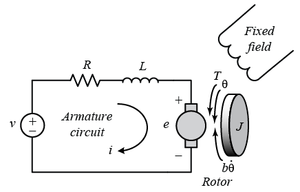
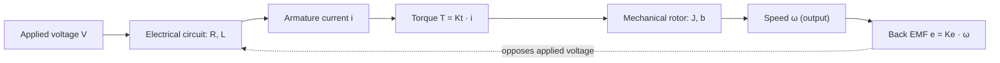

# DC Motor Speed — System Modeling

> **From the armature circuit and rotor dynamics to two equivalent mathematical models:** a **Transfer Function** and a **State-Space Representation**.

**Study:** DC motor speed (not angular position) · **Model:** continuous-time, linear, armature-controlled DC motor · **MATLAB tools:** `tf` and `ss` (Control System Toolbox).

**Goal of this section:** derive the model from physics, build both representations in MATLAB, and convert between them. **Controller design, step-response plots, and performance requirements are intentionally deferred** to later sections.

## 1. Physical setup: what are we modeling?



*Figure 1. Original circuit/rotor diagram from the [CTMS DC Motor Speed: System Modeling tutorial](https://ctms.engin.umich.edu/CTMS/index.php?example=MotorSpeed&section=SystemModeling); cropped from the study reference screenshot without redrawing. Attribution and license: [CTMS / CC BY-SA 4.0](#source-and-attribution).*

We first identify the **input** and **output**, then study the electrical and mechanical parts separately. The motor current and angular speed connect the two parts.

| Role | Symbol | Meaning |
|:--|:--|:--|
| **Input** | $V(t)$ | Voltage applied to the armature (volts) |
| **Output** | $\omega(t)=\dot\theta(t)$ | Rotor angular speed (rad/s) |
| Internal variable / state | $i(t)$ | Armature current (A) |
| Electromechanical coupling | $T(t)$ | Electromagnetic torque (N·m) |
| Electromechanical coupling | $e(t)$ | **Back EMF** induced by rotation (V) |

> **Notation check:** the applied input is **$V$**, while **$e$** in the circuit is the *back electromotive force*, not the supply voltage. Also, $\theta$ is **position**, while $\omega=\dot\theta$ is **speed**.

### Physical parameters

| Symbol | Physical meaning | CTMS example value |
|:--:|:--|--:|
| $J$ | Rotor moment of inertia | $0.01\ \mathrm{kg\,m^2}$ |
| $b$ | Viscous friction coefficient | $0.1\ \mathrm{N\,m\,s/rad}$ |
| $K_e$ | Back-EMF constant | $0.01\ \mathrm{V/(rad/s)}$ |
| $K_t$ | Torque constant | $0.01\ \mathrm{N\,m/A}$ |
| $R$ | Armature resistance | $1\ \Omega$ |
| $L$ | Armature inductance | $0.5\ \mathrm{H}$ |

**Assumptions:** rigid shaft/rotor; constant magnetic field; linear back-EMF and torque relationships; viscous friction proportional to speed; no external load torque in this example. Transfer-function derivation assumes zero initial conditions. In the CTMS example, $K_t$ and $K_e$ have **equal numerical values in consistent SI units**; the tutorial denotes both by $K$.

## 2. Connect the electrical and mechanical systems

We need two physical relationships that couple the subsystems:

**Torque from armature current**

```math
T(t)=K_t i(t)
```

**Back EMF from shaft speed**

```math
e(t)=K_e\omega(t)
```

These are not independent inputs: generated torque drives the rotor, while rotating the rotor produces a back EMF that opposes the supply voltage.



### 2.1 Mechanical equation — rotational Newton's law

The rotor torque balances inertia and viscous friction (mechanical equation):

```math
J\ddot\theta(t)+b\dot\theta(t)=K_t i(t)
```

Because our **output is speed**, define $\omega(t)=\dot\theta(t)$, so $\dot\omega(t)=\ddot\theta(t)$:

```math
J\dot\omega(t)+b\omega(t)=K_t i(t)
```

### 2.2 Electrical equation — Kirchhoff's Voltage Law

The applied voltage is shared among the inductor, resistor, and back EMF (electrical equation):

```math
V(t)=L\frac{di(t)}{dt}+Ri(t)+e(t)
```

Using $e(t)=K_e\omega(t)$:

```math
L\dot i(t)+Ri(t)=V(t)-K_e\omega(t)
```

We now have **two coupled first-order differential equations**, one mechanical and one electrical. We use the *same equations* in two different mathematical representations below.

---

## 3. Representation A — Transfer Function (Laplace)

**Purpose:** obtain one input–output relationship, $P(s)=\Omega(s)/V(s)$, by eliminating the internal current $I(s)$.

Assume zero initial conditions and take the Laplace transform of the mechanical and electrical equations:

```math
(Js+b)\Omega(s)=K_t I(s)
```

```math
(Ls+R)I(s)=V(s)-K_e\Omega(s)
```

**Step A — isolate the current** from the mechanical equation:

```math
I(s)=\frac{Js+b}{K_t}\Omega(s)
```

**Step B — substitute into the electrical equation:**

```math
(Ls+R)\frac{Js+b}{K_t}\Omega(s)=V(s)-K_e\Omega(s)
```

**Step C — collect the speed terms and divide by the input:**

```math
P(s)=\frac{\Omega(s)}{V(s)}=\frac{K_t}{(Js+b)(Ls+R)+K_tK_e}
```

For the tutorial assumption $K_t=K_e=K$:

```math
P(s)=\frac{K}{(Js+b)(Ls+R)+K^2}
```

Expand the denominator to see the system order:

```math
P(s)=\frac{K_t}{JL\,s^2+(JR+bL)s+(bR+K_tK_e)}
```

After inserting the example parameters:

```math
P(s)=\frac{0.01}{0.005s^2+0.06s+0.1001}
```

This is a **second-order** transfer function from applied voltage to angular speed.

**MATLAB:** `s = tf('s'); P_motor = Kt/((J*s+b)*(L*s+R)+Kt*Ke);`

---

## 4. Representation B — State Space (physical states)

**Purpose:** retain the system's internal dynamics rather than eliminating the current. The two energy-storage elements (rotor inertia $J$ and armature inductance $L$) motivate two independent physical states:

```math
x_1(t)=\omega(t),\qquad x_2(t)=i(t)
```

This choice is deliberate: **speed** is both the first state *and* our output; **current** is the second state. No new combined physical equation is needed—we rearrange the *same mechanical and electrical equations* from Section 2.

### 4.1 Isolate each state derivative

Mechanical equation from Section 2.1:

```math
J\dot\omega+b\omega=K_t i
```

```math
\dot x_1=\dot\omega=-\frac{b}{J}x_1+\frac{K_t}{J}x_2
```

Electrical equation from Section 2.2:

```math
L\dot i+Ri=V-K_e\omega
```

```math
\dot x_2=\dot i=-\frac{K_e}{L}x_1-\frac{R}{L}x_2+\frac{1}{L}V
```

### 4.2 Convert the two equations into matrices

The standard state-space equations are:

```math
\dot{\mathbf{x}}(t)=A\mathbf{x}(t)+Bu(t)
```

```math
y(t)=C\mathbf{x}(t)+Du(t)
```

We choose the state vector, input, and output as follows:

```math
\mathbf{x}(t)=\begin{bmatrix}\omega(t)\\i(t)\end{bmatrix},\qquad
u(t)=V(t),\qquad y(t)=\omega(t)
```

**State equation — combine the two derivative equations from Section 4.1:**

```math
\begin{bmatrix}
\dot{\omega}\\
\dot{i}
\end{bmatrix}
=
\begin{bmatrix}
-\frac{b}{J} & \frac{K_t}{J}\\
-\frac{K_e}{L} & -\frac{R}{L}
\end{bmatrix}
\begin{bmatrix}\omega\\i\end{bmatrix}
+
\begin{bmatrix}0\\\frac{1}{L}\end{bmatrix}V
```

So the **A** matrix describes how the states affect one another, and **B** describes how the applied voltage enters the state equations:

```math
A=\begin{bmatrix}
-\frac{b}{J} & \frac{K_t}{J}\\
-\frac{K_e}{L} & -\frac{R}{L}
\end{bmatrix}
\qquad
B=\begin{bmatrix}0\\\frac{1}{L}\end{bmatrix}
```

**Output equation — select only angular speed:**

Because the output is the first state, $y=\omega$, we choose **C** to select speed and **D** to be zero (no direct voltage-to-speed feedthrough):

```math
y=\begin{bmatrix}1 & 0\end{bmatrix}
\begin{bmatrix}\omega\\i\end{bmatrix}+0\,V
```

```math
C=\begin{bmatrix}1 & 0\end{bmatrix},\qquad D=0
```

With the numerical motor parameters:

```math
A=\begin{bmatrix}-10&1\\-0.02&-2\end{bmatrix}
```

```math
B=\begin{bmatrix}0\\2\end{bmatrix},\qquad
C=\begin{bmatrix}1&0\end{bmatrix},\qquad D=0
```

**MATLAB:** `motor_ss = ss(A,B,C,D)`.

---

## 5. MATLAB representation and model conversion

This section needs **no figures, no frequency-response tests, and no numerical assertions**. We simply create the transfer-function and physical state-space models, then convert between them so the two mathematical forms can be inspected in the MATLAB Command Window.

| MATLAB command | Purpose |
|:--|:--|
| `P_motor = Kt/((J*s+b)*(L*s+R)+Kt*Ke)` | Create the voltage-to-speed transfer function from the derived equation |
| `motor_ss = ss(A,B,C,D)` | Create the state-space model using physical states: speed and current |
| `P_from_ss = tf(motor_ss)` | Convert physical state space to transfer function |
| `ss_from_tf = ss(P_motor)` | Convert the transfer function to an automatically chosen state-space realization |

> **Important:** `ss(P_motor)` can use a different state-coordinate basis than our physical choice $\mathbf{x}=[\omega, i]^T$. So its matrices may look different even though the input–output transfer function is the same. Similarly, MATLAB may normalize the numerator and denominator by a common factor when displaying a transfer function.

### Run the MATLAB script

Open [`src/dc_motor_modeling.m`](src/dc_motor_modeling.m) in MATLAB and run the file, or run its `%%` sections in order:

1. **Physical parameters** — define $J$, $b$, $K_t$, $K_e$, $R$, and $L$.
2. **Transfer function** — calculate `P_motor`.
3. **State space** — build matrices $A$, $B$, $C$, $D$ and `motor_ss`.
4. **SS → TF** — create `P_from_ss`.
5. **TF → SS** — create `ss_from_tf`.

**Command Window tip:** MATLAB **does not print** an assignment if the line ends with a semicolon (`;`). The script deliberately leaves semicolons **off** the four model-object assignments above, so their results appear in the Command Window. To display $A$ or any other variable, remove its final semicolon yourself.

**Expected modeling values:**

```text
P_motor(s) = 0.01 / (0.005*s^2 + 0.06*s + 0.1001)
A = [-10, 1; -0.02, -2]
B = [0; 2]
C = [1, 0]
D = 0
```

`P_from_ss` represents the same input–output equation as `P_motor`; it can also appear in normalized form, e.g. `2 / (s^2 + 12*s + 20.02)`.

No plots or PID tuning are part of **System/Modeling**. Those belong to later sections.

## 6. Modeling conclusions

- **One physical system, two equivalent representations:** both describe the relationship from applied armature voltage to angular speed.
- **Transfer function:** compact input–output model, useful for later classical control analysis.
- **State space:** exposes the internal speed/current dynamics and the roles of $A$, $B$, $C$, and $D$.
- **Next:** evaluate responses and pole locations in `System/Analysis`, then design controllers in `Control/`.

## Source and attribution

This is an independently organized study and MATLAB implementation based on **Control Tutorials for MATLAB and Simulink (CTMS), “DC Motor Speed: System Modeling”**, developed at the University of Michigan / Carnegie Mellon University and collaborators.

- [Original CTMS modeling tutorial](https://ctms.engin.umich.edu/CTMS/index.php?example=MotorSpeed&section=SystemModeling)
- [CTMS license: Creative Commons Attribution–ShareAlike 4.0 International](https://creativecommons.org/licenses/by-sa/4.0/)
- The circuit image above is **reused (cropped) from the original CTMS figure**, not an original drawing, and remains under **CC BY-SA 4.0**. Changes: cropped to remove webpage text/UI; diagram content not changed.

**Validation status:** the model equations and numeric coefficients were independently checked during preparation. **MATLAB was not executed in this environment.**
